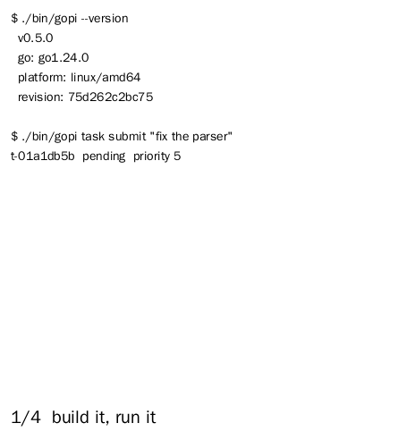
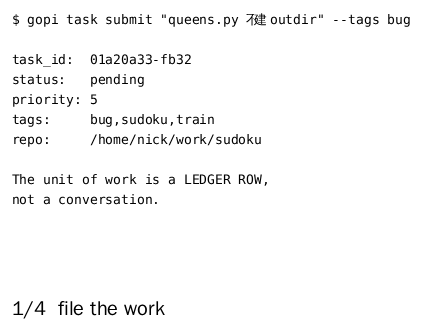
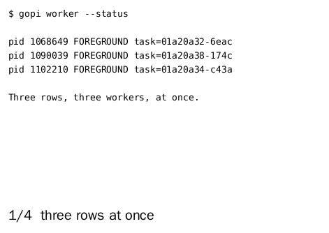
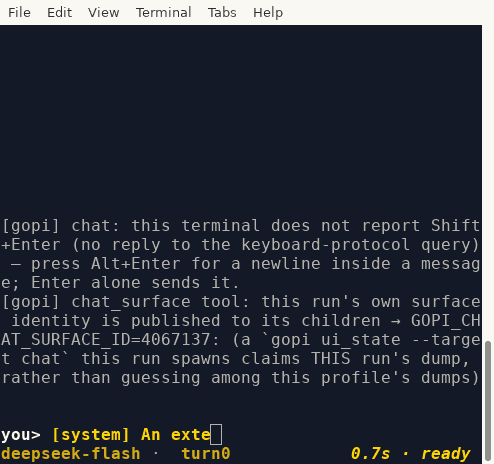
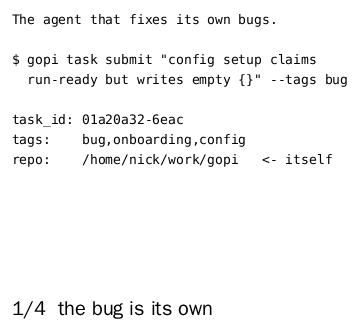

<!-- doc-class: normative -->

<div align="center">

# gopi

**An agent harness — the layer an AI coding agent runs on, which also keeps the books.**

**This project was written by an agent.** Nearly every line of it — half a million
lines of Go, in this very repository — was written by gopi itself, over four months.
Its creator does not write Go. He files the work as ledger rows, reads what comes
back, and decides direction; the code arrives from workers.

```bash
git ls-files '*.go' | xargs wc -l | tail -1     # this repository, today
```

That is not a stunt; it is the argument for everything after this paragraph.

`scripts/gopi-stats.sh` measures the rest, live, off the git object store — nothing in
it is a hard-coded number. In the full development repository (the published tree here
is a filtered subset of it):

```
1,196 production files · 532,870 lines · 13,161 functions · 100 packages
2,571 test files · 746,839 test lines · test:production ratio 1.40
2,989 markdown files · 587,918 lines of documentation
```

That last ratio is the one worth a second look: there is **40% more test code than
production code** — and that is what makes the rest of this plausible. The tests are
what check the agent's work, not a person reading every diff.

**Delegation by default.** Most coding agents stop and ask before each step —
approve this edit, approve this command. gopi is built the other way round. A
session runs commands, edits files, commits and pushes without asking, because a
supervisor who has to approve every step cannot supervise anything else. What
still requires a human is narrow and deliberate: an irreversible git ref move, a
signal to a process it does not own, a destructive system operation. Everything
else is the agent's to do, and the agent that wrote this repository is the evidence
that the arrangement works.

*Harness* is the word most readers will not know, so it leads. Most things called
"an AI app" are **not** harnesses: they are applications that sit on top of one.
gopi is the harness itself — a complete coding agent (chat, file tools, memory,
resumable sessions) **plus** the machinery a harness needs and an application does
not: a work ledger, dispatch, a clone per worker, self-merging delivery.

Your coding agent forgets the job the moment the context is compacted. gopi files
it as a **row in a ledger**, hands it to a worker that runs in its own clone, and
remembers the lesson afterward — in one static Go binary with zero runtime
dependencies.

Several agents can also work the same problem at once: **any session can message
any other session**, on this host or across machines, and each one is free to
reject the other's evidence. That is how the mistakes in this README got caught.

[](LICENSE)
[](https://go.dev/dl/)
[](#why-one-binary)

[English](README.md) · [简体中文](README.zh-CN.md) · [Install](INSTALL.md) · [Commands](COMMANDS.md) · [Config](CONFIG.md)

</div>



*Every frame above is a real command's real output — rendered to PNG by `gopi tool text2img`
and assembled by `gopi tool gif`. Both are this binary. No ffmpeg, no ImageMagick in the
chain ([recipe](docs/quickstart.md)).*

---

## The 30-second version

```bash
git clone https://github.com/nickhuang99/gopi.git && cd gopi
make build
./bin/gopi --version
```

Then:

```bash
./bin/gopi config setup      # idempotent: fills in what is missing, touches nothing that exists
./bin/gopi chat              # start talking
```

You need **Go 1.24+** to build, and **one API key** to talk to a model.
Nothing else — no Node, no Python, no Docker, no `node_modules`.

---

## What makes it different

Most agent harnesses answer *"how do I chat with a model that edits files?"*
gopi answers a different question: **"how does one person run a software company
without hiring anyone?"** That changes what the core object is.

### 1. The unit of work is a ledger row, not a conversation

In a mainstream agent you finish talking, the context is compacted, and the work
leaves no trace. In gopi a piece of work is a **row** with an id, a state machine,
a claimer, a delivery branch, and a session directory you can re-read months later.

```bash
$ gopi task submit "把 config 加载路径从相对改成绝对" --tags refactor
Task queued: 01a201ec-3cbc-7af2-ace5-e554fbb102dc (status=pending, source=agent, tags=refactor)
```

That row survives crashes, reboots and `rm -rf ~/.gopi`. Ask it anything later:

```bash
gopi task show 01a201ec-3cbc-7af2-ace5-e554fbb102dc   # status, holder, parent, payload revisions, delivery proof
gopi task list --status pending                        # what is claimable, and why a row is parked
```

**A failure is not a dead end.** `gopi worker --resume <id>` continues the same
row in the same directory with the checkpoint appended; `gopi task clone <id>`
gives a clean-room copy that redoes the work from scratch. Which one is right is
decided by `gopi task status <id>`'s exit code, not by your memory of what happened.

### 2. A worker runs in its own clone and merges itself

The whole system exists so that **you are not the one holding the context.**
`gopi worker` claims a row, clones the repo to a private directory, does the work,
builds it, pulls the integration branch, **resolves the conflicts itself**, and
pushes. Then the row carries the proof.

```bash
$ gopi worker 01a201ec-3cbc-7af2-ace5-e554fbb102dc
# ... runs in isolation, then ...
clone-channel: attempt 1/M: push accepted
```

A run that cannot deliver says so, by name, in its own log — never silence.

### 3. Memory is a subsystem, not a vector store bolted on

Three tiers, all queryable, all searchable, all voted on:

| Tier | What it holds | How you ask |
|---|---|---|
| Distilled | one reusable lesson per row: topic / question / answer / keywords | `gopi memory search "为什么 build 会红"` |
| Procedural | reusable workflows, as ordered steps | ``gopi memory search "<task>"`` |
| Session index | every round of every past run, one searchable note each | `gopi session notes "<query>"` |

Retrieval is **automatic** — the right lessons are prefetched into the prompt
before you ask. Feedback moves confidence, so bad entries sink and good ones rise.

### 4. Several agents can work the same problem — and correct each other

This is the capability we would put first if we could only keep one. Claude Code ships it
too, and reaches sessions on other machines; the difference that matters to us is the peer —
there it is another session of the same user, here the peer **is a dispatched worker on a
ledger row**, and a message can redirect work that is already running.

A gopi session can message **another agent's session** — on this host or across
machines — with a tool call or one command:

```bash
$ gopi notify --session <other-session-id> --message "$(cat findings.md)"
delivered: 1 message into .../messages/inbox.jsonl
```

The message lands in that session's own inbox and is taken at its **next round
boundary**: a running turn is never interrupted mid-thought, and a session that
is idle wakes to read it. The receiving agent can answer back the same way, so
two agents hold a conversation with each other, not through you.

```bash
gopi notify --peer hp --session <id> --message "..."   # across hosts, over the declared ssh leg
```

**Why it is not a chat room.** Each session keeps its own task list, its own
ledger rows, its own git ground. What crosses the wire is *evidence* — a command
and its output — and the receiving agent is free to reject it. That is the point:
a second pair of eyes that can say "your measurement does not support your
conclusion".

**What that looks like in practice.** In one working session on this project,
two agents spent a day on the same ledger. They overturned each other repeatedly:

- One reported "3 rows still carry the old token format". The other pulled the
  raw rows and showed the criterion that produced `3` was itself faulty — the
  correct count was **zero**. The first claim was withdrawn.
- One submitted a bug titled "the console hard-codes an absolute path". The other
  showed the absolute path came from **`bash`'s tilde-expansion in the reporter's
  own echo**, not from the program — the source line contained `~`. That bug row
  was cancelled as a false report.
- One claimed a 2002-line deliverable "was never committed". The other walked the
  file blobs and found the content **had** landed, under a different commit hash
  (the delivery channel rebases, so hashes are rewritten by design). The verdict
  flipped from "work lost" to "work landed".

Both agents were wrong about something that day, and both were right about
something the other had wrong. **A single agent cannot do that**: nothing in its
own context disagrees with it.

**The honest boundary.** Delivering a message is immediate; **acting on it
depends on the receiving agent reaching a round boundary**, which can be minutes.
An agent that is stuck in a loop never reads its inbox — the mechanism informs a
working agent, it does not rescue a broken one. Cross-host delivery needs a
declared peer and a working ssh leg; it fails loudly, with the reason, when
either is missing.

See [`examples/session-collaboration/`](examples/session-collaboration/) for a
worked two-agent exchange.

### 5. It can see the screen and act on it

Not a screenshot tool bolted on: a hand-rolled X11 protocol client, pure Go,
zero CGO. Capture → read → act → verify, with the pixel hashes to prove it changed.

```bash
gopi tool capture --self                    # the terminal gopi itself runs in, resolved by pid
gopi tool vision_analyze shot.png   # what does this screen say?
gopi tool act move 640 400                  # drive the real desktop
```

---

## See it working

**13 worked examples** — `ls -d examples/*/ | wc -l` is the count, and every directory is in
[`examples/README.md`](examples/README.md). Nine are linked from this page; each is built from a
**real run**, and the outputs are verbatim, not mock-ups.

<table>
<tr>
<td width="50%"></td>
<td width="50%"></td>
</tr>
<tr>
<td><b>Dispatch a row, let a worker run it</b><br><code>submit</code> → a clone → a worker → a commit back. <a href="examples/workflow-dispatch/">walkthrough</a></td>
<td><b>Several projects at once</b><br>Independent rows, each in its own clone, no shared working directory. <a href="examples/parallel-projects/">walkthrough</a></td>
</tr>
<tr>
<td></td>
<td></td>
</tr>
<tr>
<td><b>Two agents that correct each other</b><br>A real inbox exchange — one agent overturns the other's claim. <a href="examples/session-collaboration/">walkthrough</a></td>
<td><b>gopi works on gopi</b><br>This repository is developed by its own workers, on its own ledger. <a href="examples/self-development/">walkthrough</a></td>
</tr>
</table>

Five more, each about one mechanism:

- **[Session replay](examples/session-replay/)** — stream a finished session back, byte for byte, without touching the model.
- **[Token and cache](examples/token-and-cache/)** — what a run cost, and proof the count is not an estimate.
- **[Resume after failure](examples/resume-after-failure/)** — a failure judges one attempt, not the work.
- **[Voice input](examples/voice-input/)** — four engines, one command; real numbers, including the ones that are worse.
- **[Not believing "completed"](examples/worker-false-completion/)** — a status a run writes about itself is not a measurement; the three shapes of "done" that are not done.

---

## gopi vs. the mainstream harnesses

| | gopi | Crush | Claude Code | Pi | Codex CLI |
|---|---|---|---|---|---|
| **Runtime deps** | none (static binary) | Go binary | Node.js 18+ | Node.js 22.19+ | see its README |
| **Unit of work** | ledger row, survives the session | session | session | session | session |
| **Work survives context compaction** | yes — it is a database row | no | no | no | no |
| **Unattended dispatch** | `gopi worker` claims and runs rows | not in README | not in README | print/JSON mode | not in README |
| **Agent-to-agent messaging** | any session messages any other session, on this host or across machines; the receiver takes it at its next round boundary and may reject the sender's evidence | one-way only — MCP **Channels** push events *into* a session; no session addresses another | yes — **cross-session messaging** (`ListAgents` / `SendMessage`, v2.1.224+, other machines included) and **agent teams** (experimental); a peer's request is treated as input, not authority | none — its README: "skips features like sub-agents" | subagents only — a parent spawns parallel agents that report summaries back to the main thread |
| **Isolation per task** | its own git clone, auto-reclaimed | not in README | not in README | not in README | sandbox |
| **Long-term memory** | 3 tiers + FTS + feedback + auto-prefetch | not in README | not in README | not in README | not in README |
| **Desktop control** | pure-Go X11 (no deps) | not in README | not in README | not in README | not in README |
| **Multi-provider** | DeepSeek (BYOK), Anthropic/OpenAI-compatible via proxy | many | Anthropic | many | OpenAI |

<sub>The messaging row is measured, not read off READMEs (checked 2026-11-24, sources named):
Claude Code — [code.claude.com/docs/en/cross-session-messaging](https://code.claude.com/docs/en/cross-session-messaging)
and [code.claude.com/docs/en/agent-teams](https://code.claude.com/docs/en/agent-teams) (its own
README does not mention it at all); Codex — [developers.openai.com/codex/subagents](https://developers.openai.com/codex/subagents);
Crush — its README's Channels section; Pi — its README. This row does **not** say gopi's
mechanism is better: Claude Code reaches other sessions **and other machines**, and it treats a
peer's message as input rather than authority — a boundary gopi does not draw. What gopi claims
here is narrower and checkable: the peer can be a **dispatched worker on a ledger row**, the
message is **durable when the receiver is not running**, and the sender's evidence can be
**rejected and re-derived** instead of complied with.</sub>

<sub>`not in README` means exactly that: the string did not appear in that project's own
README when this table was written. It is **not** a claim that the capability is absent —
most of these tools can do more through plugins. Read every row as "what each project
chose to advertise", never as a feature audit. Counts and quotes are from each project's own README;
re-check before relying on this table.</sub>

**Where gopi is weaker, honestly:** no MCP, Linux-only release binaries (macOS
cross-compiles but has never been run), one model family out of the box, no
npm/brew package. See [§ Boundaries](#boundaries).

---

## Installation

Pick the one that matches you.

### Download a prebuilt binary (no toolchain needed)

Every release carries a ready-to-run binary, built by GitHub Actions:

**[→ Latest release](https://github.com/nickhuang99/gopi/releases/latest)**

| Platform | File |
|---|---|
| Linux x86-64 | `gopi_<version>_linux_amd64` |
| Linux ARM64 | `gopi_<version>_linux_arm64` |

```bash
VER=v0.5.2
curl -fLO "https://github.com/nickhuang99/gopi/releases/download/${VER}/gopi_${VER}_linux_amd64"
curl -fLO "https://github.com/nickhuang99/gopi/releases/download/${VER}/gopi_${VER}_linux_amd64.sha256"
sha256sum -c "gopi_${VER}_linux_amd64.sha256"
chmod +x "gopi_${VER}_linux_amd64"
./gopi_${VER}_linux_amd64 --version
```

Then put it somewhere on your `PATH`:

```bash
mv gopi_${VER}_linux_amd64 ~/.local/bin/gopi
```

**The releases carry Linux only, but macOS now cross-compiles.** The darwin split
landed (2026-11-23): `syscall.Fsid` names its field `Val` on darwin against linux's
`X__val`, `Statfs_t.Type`/`Bsize` are `uint32` there, `Stat_t` spells the timestamps
`Ctimespec`/`Mtimespec`, and `SysProcAttr` has **no** `Pdeathsig` field — each is now
behind a per-platform file. Measured on that rev: `GOOS=darwin GOARCH=arm64` builds a
working `Mach-O 64-bit arm64 executable` (72 MB), and linux still builds.

**Windows does not build**, and honestly will not soon — the gap is not syntax.
`syscall.RLIMIT_AS` / `Rlimit` / `Getrlimit` (rlimit), `O_NOFOLLOW`, and a batch of
statfs call sites have no POSIX counterpart there, so each needs a real mechanism
rather than a field rename. The release workflow publishes the two targets measured
to build rather than three where one is permanently red. See [§ Boundaries](#boundaries).

**Darwin is compiled, not run** — no macOS machine was available, so treat it as
"it builds" rather than "it works". Three things are known degraded there and each
says so at its own call site: `Pdeathsig` is absent (a filmed child outlives a
SIGKILLed parent), pty text capture is unavailable (it needs `TIOCPTYGNAME` plus
`grantpt`/`unlockpt`, which are libc and this binary is `CGO_ENABLED=0`), and
`cgroupscope`'s `/proc/self/cgroup` has no darwin equivalent.

### Install Go first — read this before you clone

gopi needs **Go 1.24.0 or newer**, and that is a hard requirement, not a preference.
`go.mod` declares `go 1.24.0`, and **four of the direct dependencies declare the same
floor in their own `go.mod`** — `modernc.org/sqlite v1.44.0`, `golang.org/x/sys v0.37.0`,
`github.com/charmbracelet/bubbletea v1.3.10`, `github.com/go-ego/gse v1.1.0`. An older
toolchain refuses the build outright; there is no fallback path.

```bash
go version          # must print go1.24.0 or higher
```

**Do not use your distribution's package manager.** On Ubuntu 22.04 the candidate is
`2:1.18~0ubuntu2` — six releases too old — so `sudo apt install golang-go` produces a
toolchain that cannot build this tree. (Measured: `apt-cache policy golang-go`.) Install
the upstream toolchain instead:

**Ubuntu / any x86-64 Linux**

```bash
curl -fLO https://go.dev/dl/go1.24.0.linux-amd64.tar.gz
sudo rm -rf /usr/local/go && sudo tar -C /usr/local -xzf go1.24.0.linux-amd64.tar.gz
export PATH=$PATH:/usr/local/go/bin     # also add this line to ~/.bashrc or ~/.profile
go version                              # go1.24.0 linux/amd64
```

On ARM64 use `go1.24.0.linux-arm64.tar.gz` in the same two lines.

**macOS** — Homebrew (`brew install go`) or the official `.pkg` from
<https://go.dev/dl/>; both are current. Verify with `go version`.

**Windows** — the official MSI installer from <https://go.dev/dl/>. Verify with
`go version` in a fresh terminal.

> If your `go version` is older and you expected Go to upgrade itself: it will not.
> `GOTOOLCHAIN=local` is the default in many environments, and a `go` line newer than
> your toolchain is a hard build error, not an auto-upgrade trigger.

### From source

```bash
go version                         # must be 1.24.0 or newer — hard requirement
git clone https://github.com/nickhuang99/gopi.git
cd gopi
make build                         # → ./bin/gopi
./bin/gopi --version
```

Put it on your `PATH`:

```bash
make install                        # → $(go env GOPATH)/bin/gopi
make install PREFIX=/usr/local/bin  # or somewhere already on PATH
```

### Bring your own key

gopi ships **no credentials**. It is built around **DeepSeek**; the model name in
`settings.example.json` is a placeholder you replace with your own key from
<https://platform.deepseek.com/>.

```bash
cp settings.example.json ~/.gopi/settings.json
$EDITOR ~/.gopi/settings.json       # replace "PUT-YOUR-OWN-DEEPSEEK-KEY-HERE"
```

Without a key gopi still starts, and every command that does not call a model still
works — it tells you which key is missing instead of failing silently.

### Voice input (optional, and it is NOT DeepSeek)

Dictation is a **separate subsystem with its own account and its own bill**. Two
engines, and neither is the LLM provider:

| Engine | Weights on disk | Audio leaves the machine | What you need |
|---|---|---|---|
| `--engine doubao` (default) | **0 B** — nothing to download | **yes**, uploaded | a Volcengine (ByteDance) SAUC account: app id + access token |
| `--engine local` | **1.7 GB on disk** (910 MB loaded per run) | **no** | those files, plus a ~6 MB runtime you build |

**Cloud engine.** Speech-to-text is Volcengine SAUC (the 豆包 / Doubao large-model
ASR service), not DeepSeek. Different vendor, different console, different invoice.
The commented `_voice_optional` block in `settings.example.json` carries the shapes —
endpoint `wss://openspeech.bytedance.com/api/v3/sauc/bigmodel_async`, resource id
`vol.seedasr.sauc.duration`. **Leave those keys out and nothing breaks**: the voice
path reports "not configured" when you call it, and every other command is
unaffected.

**Local engine.** Fun-ASR-Nano (SAN-M encoder + Qwen3-0.6B) running on your own CPU
through the official FunASR **llama.cpp** runtime — 1.7 GB of weights on disk
(910 MB loaded per run) that never leave disk, and no audio leaves the machine. Same clip, same scorer, measured:

```
Fun-ASR-Nano (local)   CER 1.58%   at 0.32x realtime
whisper-small          CER 5.14%   at 0.95x realtime
whisper-medium         CER 2.77%   at 3.4x  realtime
```

That is better accuracy than whisper-medium at a tenth of its compute cost. The
catch is honest and it is deployment, not quality: **you have to obtain the
weights — 1.7 GB on disk — and compile a C++ runtime.** gopi does not ship either, and does not download
them for you.

Where gopi looks for a local deployment, in order:

```
<gopi profile>/voice           i.e. ~/.gopi/voice   ← what it prefers
$HOME/work/funasr-models                            ← legacy, read-only
```

When neither is there it loads nothing, names the missing file, and prints the
directory to put it in — plus the way to need none of it (`--engine doubao`).
close to 2 GB of weights plus a foreign runtime is a normal thing *not* to have installed,
and gopi treats it that way rather than as a broken install.

**If you do not want dictation at all, ignore this section entirely.** Nothing else
in gopi touches it. Background: `devdoc/doubao-audio-endpoint-credential-config.md`
and `devdoc/audio-engine-config-surface.md`.

### Verify the install

```bash
gopi config setup     # idempotent provisioning
gopi config show      # the config IN FORCE, and which channel decided each value
gopi chat             # start talking
```

`gopi config show` prints the **parsed result**, not the file, and beside each value
the channel that won (flag / env / settings.json / default). When behaviour disagrees
with what you wrote, that is the page to read.

**Platform: Ubuntu 22.04 LTS, x86-64, Go 1.24.x** — the only combination that has been
**run**. macOS cross-compiles but has never been executed, Windows does not compile, and
no other distribution is tested; the honest list is [`INSTALL.md` §6](INSTALL.md).

---

## What it can do

There are **13 top-level verbs**, and that number is counted, not remembered: the
`Commands` block of `gopi -h` names 12 words (`chat`, `config`, `memory`,
`notify`, `screen`, `screen-replay`, `session`, `task`, `tool`, `ui_state`,
`web`, `worker`) and the `Usage` block names the thirteenth, `gopi version`. This
page groups them by what you are trying to do, not by how the CLI happens to be
organised — `gopi -h` is the complete list, and it is the authority for whether a
command exists. Under that one door sit **18 `gopi tool` commands** (`gopi tool -h`:
15 direct + 3 grouped).

Every command below **really runs** — none is an illustration.

A command may appear under two headings. That is deliberate: the grouping is by
*your goal*, and one command can serve two of them.

### 1. Talk to one agent

| I want to | Command |
|---|---|
| Talk to it interactively | `gopi chat` |
| Finish one small job in one shot, no loop | `gopi chat --once -p "把这个函数的错误分支补上"` |
| Use a browser instead of a terminal | `gopi web --addr 127.0.0.1:8080` |
| Read what the console is painting, as a cell grid | `gopi ui_state --json` |

### 2. Dispatch work and follow it

| I want to | Command |
|---|---|
| Hand over a job that outlives this conversation | `gopi task submit "<the work>"` |
| See where a piece of work is right now | `gopi task show <id>` |
| Is the process behind it actually alive? | `gopi task status <id>` |
| Find work nobody has claimed | `gopi task list --status pending` |
| Run the queue unattended | `gopi worker` |
| Search the ledger for past work | `gopi task search "<what you remember>"` |
| Retire a finished row, keeping its record | `gopi task archive <id>` |
| Clean finished tasks' working dirs | `gopi task sweep-worktrees` |

### 3. Remember, and look things up

| I want to | Command |
|---|---|
| Make it remember one reusable lesson | `gopi memory store --topic "..." --question "..." --answer "..."` |
| Ask whether it has hit this before | `gopi memory search "为什么 build 会红"` |
| Vote a recalled lesson useful or useless | `gopi memory feedback <id> --useful` |
| Recompute a row's index after a model change | `gopi memory backfill-tokens` |
| Find a symbol **definition** | `gopi tool code-search <Symbol>` |
| Full-text search the tree | `gopi tool keyword_search "<pattern>"` |
| Find who wrote a line, and why | `git_blame` inside a session; `git blame` on the CLI |

### 4. Prove what actually happened

This is the group most harnesses do not have, and the reason two of the 13 verbs
exist at all.

| I want to | Command |
|---|---|
| List past runs | `gopi session list` |
| Read one run turn by turn | `gopi session log --last` |
| The raw bytes sent to the model | `gopi session raw --last` |
| What it cost, hit rate included | `gopi session stats --last` |
| Resume an interrupted conversation | `gopi --session <id>` |
| Replay a recorded screen | `gopi screen replay <id>` |
| Diff two recordings byte for byte | `gopi screen-replay --verify A B` |
| Which build am I running? | `gopi version` |
| Deliver a message to another session | `gopi notify --session <id> --message "..."` |
| Read the task event stream | `gopi notify events` |

### 5. Let it see the screen, and act on it

| I want to | Command |
|---|---|
| Capture the live desktop | `gopi tool capture --screen --out s.png` |
| Capture the terminal gopi itself runs in | `gopi tool capture --self` |
| Drive the desktop | `gopi tool act move 100 100` |
| Read what is in an image | `gopi tool vision_analyze <image>` |
| Draw marks onto an existing PNG | `gopi tool annotate in.png --out marked.png --mark "rect:200x40+14+13::fixed"` |
| Screenshot a web page, headless | `gopi tool shot --url https://example.com` |
| Render text to an image (CJK-capable) | `gopi tool text2img <input.txt>` |
| Turn PNG frames into one animated GIF | `gopi tool gif --frames a.png,b.png,c.png --out out.gif` |
| Transcribe audio | `gopi tool voice_input <audio>` |
| Search / fetch the web | `gopi tool web search "<query>"` |

### 6. Configure it, count it, contain it

| I want to | Command |
|---|---|
| See the config **in effect**, and which channel decided each value | `gopi config show` |
| Measure this host and describe its environment | `gopi config env` |
| Provision a fresh machine | `gopi config setup` |
| Tab-completion for your shell | `gopi config completion bash` |
| Count tokens against the provider's own number | `gopi tool tokens --session <session-id>` |
| Run once in a private profile | `gopi tool sandbox run --label probe -- <cmd>` |
| See what temp dirs can be reclaimed | `gopi tool scratch-gc --dry-run` |
| Serve an Anthropic-shaped endpoint from an OpenAI one | `gopi tool proxy --upstream openai` |

Two `tool` entries are deliberately internal — `gopi tool -h` marks exactly those
two `(internal)`: `scratch-gc` and `ledger-window`. `screen_capture` is the
whole-screen spelling of `capture`, and `text2img-verify` exists to check the
renderer's own pixel accuracy. They are real and they run; their output is a
contract for this repository's own gates, so a script may depend on it and a
person should not. They are listed here rather than hidden, because a capability
with no door can only be tested by unit tests.

---

## Boundaries

gopi is **not** "does everything". These are deliberate trade-offs, not a to-do list:

- **No MCP.** There is a plugin tree, but no Model Context Protocol client. Adding MCP
  means a new protocol plus a resident connection, which trades against "zero
  dependencies, one binary". **Awaiting a ruling, not awaiting implementation.**
- **No hosted install script.** No `curl … | sh`. A script that comes off the network
  and runs with your privileges is a dependency not pulled in lightly.
- **It will not install software on someone else's machine for you.** Gathering
  evidence, probing and verifying are allowed; "install a third-party agent so a test
  can run once" is forbidden.
- **No latency promise under device load.** gopi does not generate load to measure
  anything, so it makes no claim about performance under contention.
- **Two platforms build, one has been run.** Linux x86-64 is the only combination that has
  been **run**. Linux ARM64 is built and published — measured to compile and to carry
  the version stamp, **not** measured to execute, because the CI runner is amd64 and
  no emulator is set up. macOS **cross-compiles** since the darwin split landed
  (2026-11-23: `Fsid.Val` vs `X__val`, `Statfs_t.Type` signedness, `Ctimespec`/`Mtimespec`,
  the missing `Pdeathsig`) — measured to produce a working arm64 Mach-O, but **never
  executed on a Mac**. Windows **does not compile**, and the gap is not syntax: rlimit,
  `O_NOFOLLOW` and a batch of statfs call sites have no Windows counterpart.
- **This public export ships no test suite.** `make test` runs `go build ./...` plus
  `go vet ./...` — the two checks that mean something on product code alone. `_test.go`
  files and `internal/standards/` stayed in the private tree. **A `go test` command
  quoted anywhere in these docs names a test that is not in this repository: it prints
  `no tests to run` and exits 0. That is a vacuous green, not a passing check.**
  Verify behaviour by running the binary.

---

## Documentation

| What you want | Where |
|---|---|
| **Install on a fresh machine, and exactly what is required** | [`INSTALL.md`](INSTALL.md) |
| **Every CLI verb in full** | [`COMMANDS.md`](COMMANDS.md) — 421 lines, by verb |
| **Every config key's default, precedence, and the line that reads it** | [`CONFIG.md`](CONFIG.md) — 1649 lines |
| **The official description of a subsystem** | [`man/`](man/) — 14 pages |
| **Why the code looks this way** | [`PROJECT.md`](PROJECT.md) — 37 engineering rules |
| **The measurements behind design decisions** | [`devdoc/`](devdoc/) — each declares its doc-class on line 1 |
| **What changed** | [`CHANGELOG.md`](CHANGELOG.md) |

> Figures in that table come from `wc -l <file>` and `ls man/*.md | wc -l`. Re-run them
> yourself; this export ships no gate that would catch a stale one.

---

## Status

`v0.5.2` — the first public tree. Under active development: interfaces will change,
but every change is recorded in `CHANGELOG.md`.

```bash
$ ./bin/gopi --version
v0.5.2
go: go1.24.0
platform: linux/amd64
revision: <the commit you built from>
```

`revision` is baked in at build time, so it names the commit *your* binary came from —
which is why it is not written down here.

## License

MIT — see [`LICENSE`](LICENSE).
