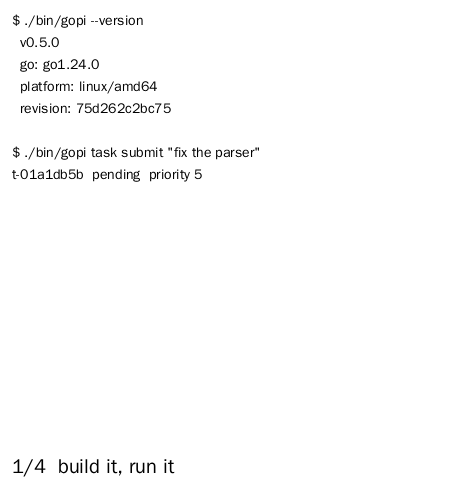

<!-- doc-class: normative -->

<div align="center">

# gopi

**一个会记账的 agent。**

你的编程 agent 在上下文被压缩的那一刻就忘了这件事。
gopi 把它记成**账本里的一行**，交给一个在独立 clone 里跑的 worker，
做完之后把经验留下来 —— 全部装在一个零运行时依赖的静态 Go 二进制里。

[](LICENSE)
[](https://go.dev/dl/)
[](#为什么是单二进制)

[English](README.md) · 简体中文 · [安装](INSTALL.md) · [命令](COMMANDS.md) · [配置](CONFIG.md)

</div>



*上面每一帧都是一个真实命令的真实输出 —— 由 `gopi tool text2img` 渲染成 PNG、
由 `gopi tool gif` 拼成 GIF。两个都是这个二进制自己。整条链没有 ffmpeg、没有
ImageMagick（[复现配方](docs/quickstart.md)）。*

---

## 30 秒上手

```bash
git clone https://github.com/nickhuang99/gopi.git && cd gopi
make build
./bin/gopi --version
```

然后：

```bash
./bin/gopi config setup      # 幂等：缺什么补什么，已有的一个字都不动
./bin/gopi chat              # 开始对话
```

构建需要 **Go 1.24+**，跟模型说话需要**一个 API key**。
别的都不要 —— 不要 Node、不要 Python、不要 Docker、不要 `node_modules`。

---

## 它和别的 agent 哪里不一样

大多数 agent harness 回答的是「怎么跟一个会改文件的模型聊天」。
gopi 回答的是另一个问题：**一个人怎么在没有雇员的情况下运营一家软件公司。**
问题不一样，核心对象就不一样。

### 1. 工作单位是账本里的一行，不是一段对话

主流 agent 里，你说完、上下文压缩、这件事就不留痕迹了。在 gopi 里，一件工作是一**行**：
有 id、有状态机、有认领人、有交付分支、有一个几个月后还能翻出来读的会话目录。

```bash
$ gopi task submit "把 config 加载路径从相对改成绝对" --tags refactor
Task queued: 01a201ec-3cbc-7af2-ace5-e554fbb102dc (status=pending, source=agent, tags=refactor)
```

这一行能挺过崩溃、重启和 `rm -rf ~/.gopi`。事后可以问它任何事：

```bash
gopi task show 01a201ec-3cbc-7af2-ace5-e554fbb102dc   # 状态、认领人、父行、payload 修订史、交付证据
gopi task list --status pending                        # 什么能被认领，以及某行为什么被挡住
```

**失败不是终点。** `gopi worker --resume <id>` 在同一行、同一目录里接着跑，checkpoint 追加；
`gopi task clone <id>` 给一个干净房间，从头重做。该用哪个由 `gopi task status <id>` 的**退出码**
决定，不由你对当时情况的记忆决定。

### 2. worker 在自己的 clone 里跑，自己合并

整个系统存在的意义是：**持有上下文的那个不是你。**
`gopi worker` 认领一行、把仓库 clone 到私有目录、干活、构建、拉集成分支、
**自己解决冲突**、推送。然后这一行带着证据。

```bash
$ gopi worker 01a201ec-3cbc-7af2-ace5-e554fbb102dc
# ...在隔离环境里跑完...
clone-channel: attempt 1/M: push accepted
```

交不出去的运行会点名说清楚（`clone channel: delivery did not land — …`），**不会沉默**。

### 3. 记忆是一个子系统，不是外挂一个向量库

三层，全部可查、可搜、可投票：

| 层 | 装什么 | 怎么问 |
|---|---|---|
| 蒸馏 | 一行一条可复用经验：主题 / 问题 / 答案 / 关键词 | `gopi memory search "为什么 build 会红"` |
| 流程 | 可复用工作流，按步骤排列 | `gopi memory search "<任务>"` |
| 会话索引 | 过去每一次运行的每一轮，各一条可搜笔记 | `gopi session notes "<query>"` |

检索是**自动的** —— 相关的经验在你问之前就被预取进提示词。
反馈会推动置信度，所以差的沉下去、好的浮上来。

### 4. 它能看屏幕、也能操作屏幕

这不是外挂一个截图工具：是手写的 X11 协议客户端，纯 Go，零 CGO。
捕获 → 读 → 操作 → 验证，每一步都有像素哈希证明它真的变了。

```bash
gopi tool capture --self                    # gopi 自己所在的那个终端，按 pid 解析，不会抓错窗口
gopi tool vision_analyze --image shot.png   # 这张屏幕说了什么？
gopi tool act move 640 400                  # 操作真实桌面
```

---

## gopi 与其他主流 harness

| | gopi | Crush | Claude Code | Pi | Codex CLI |
|---|---|---|---|---|---|
| **运行时依赖** | 无（静态二进制） | Go 二进制 | Node.js 18+ | Node.js 22.19+ | 见其 README |
| **工作单位** | 账本行，跨会话存活 | 会话 | 会话 | 会话 | 会话 |
| **上下文压缩后工作还在吗** | 在 —— 它就是一条数据库记录 | 不在 | 不在 | 不在 | 不在 |
| **无人值守派发** | `gopi worker` 认领并跑完 | README 未提及 | README 未提及 | print/JSON 模式 | README 未提及 |
| **每个任务的隔离** | 独立 git clone，自动回收 | README 未提及 | README 未提及 | README 未提及 | sandbox |
| **长期记忆** | 三层 + FTS + 反馈 + 自动预取 | README 未提及 | README 未提及 | README 未提及 | README 未提及 |
| **桌面控制** | 纯 Go X11，无依赖 | README 未提及 | README 未提及 | README 未提及 | README 未提及 |
| **多模型** | DeepSeek（自带 key），Anthropic/OpenAI 兼容经 proxy | 多家 | Anthropic | 多家 | OpenAI |

<sub>「README 未提及」就是这个意思：本表写作时，那个字符串没有出现在该项目自己的 README 里。
它**不是**「对方没有这个能力」的断言 —— 其中大多数通过插件能做到更多。请把每一行读成
「各家选择宣传什么」，绝不要当成功能审计。数字与引文均取自各项目自己的 README，
依赖本表之前请自行复核。</sub>

**gopi 弱在哪里，诚实写出来：** 没有 MCP、没有 ARM/macOS/Windows 构建、
开箱只有一家模型、没有 npm/brew 包。见[§ 边界](#边界)。

---

## 安装

挑适合你的一种。

### 从源码（今天就能用）

```bash
go version                         # 必须 1.24.0 或更新 —— 硬性要求
git clone https://github.com/nickhuang99/gopi.git
cd gopi
make build                         # → ./bin/gopi
./bin/gopi --version
```

放进 `PATH`：

```bash
make install                        # → $(go env GOPATH)/bin/gopi
make install PREFIX=/usr/local/bin  # 或者一个已经在 PATH 里的地方
```

### 自带 key

gopi **不附带任何凭据**。它围绕 **DeepSeek** 构建；`settings.example.json` 里的模型名是占位符，
换成你自己从 <https://platform.deepseek.com/> 拿的 key。

```bash
cp settings.example.json ~/.gopi/settings.json
$EDITOR ~/.gopi/settings.json       # 替换 "PUT-YOUR-OWN-DEEPSEEK-KEY-HERE"
```

没有 key gopi 照样能启动，所有不调用模型的命令照样能用 —— 它会告诉你缺哪个 key，
而不是静默失败。

### 验证安装

```bash
gopi config setup     # 幂等准备
gopi config show      # 实际生效的配置，以及每一个值是被哪个通道决定的
gopi chat             # 开始对话
```

`gopi config show` 打印的是**解析后的结果**，不是文件内容，而且每个值旁边写着哪个通道赢了
（命令行 flag / 环境变量 / settings.json / 默认值）。当行为和你在文件里写的对不上时，
读那一页。

**平台：Ubuntu 22.04 LTS、x86-64、Go 1.24.x** —— 唯一跑过的组合。
macOS、Windows、ARM、其他发行版都没测过；诚实清单在 [`INSTALL.md` §6](INSTALL.md)。

---

## 它能做什么

下面每一条命令都**真的能跑**，没有一个是示意。

### 对话与执行

| 我想 | 命令 |
|---|---|
| 跟它说话 | `gopi chat` |
| 一次干完一件小事，不进循环 | `gopi chat --once -p "把这个函数的错误分支补上"` |
| 派一件活，稍后收结果 | `gopi task submit "<这件事>"` |
| 看某件活现在走到哪一步 | `gopi task show <id>` |
| 找没人认领的活 | `gopi task list --status pending` |
| 无人值守地消费队列 | `gopi worker` |

### 记忆与检索

| 我想 | 命令 |
|---|---|
| 让它记住一条可复用经验 | `gopi memory store --topic "..." --question "..." --answer "..."` |
| 问它以前是否碰到过 | `gopi memory search "为什么 build 会红"` |
| 找某个符号的定义 | `gopi tool code-search <Symbol>` |
| 全文搜索代码树 | `gopi tool keyword_search "<pattern>"` |
| 查某一行是谁写的、为什么 | 会话内 `git_blame` 工具；命令行 `git blame` |

### 看与操作

| 我想 | 命令 |
|---|---|
| 捕获当前桌面 | `gopi tool capture --screen --out s.png` |
| 捕获它自己所在的那个终端 | `gopi tool capture --self` |
| 操作桌面 | `gopi tool act move 100 100` |
| 读出图片里是什么 | `gopi tool vision_analyze --image p.png` |
| 把文本渲染成图片（支持中日韩） | `gopi tool text2img --src notes.txt` |
| 给网页截图（无头，不碰真实屏幕） | `gopi tool shot --url https://example.com` |

### 配置与自省

| 我想 | 命令 |
|---|---|
| 看**实际生效**的配置 | `gopi config show` |
| 列出所有环境变量 | `gopi config show --help-env` |
| 把一台新机器准备好 | `gopi config setup` |
| 查任意动词的用法 | `gopi <verb> -h` |

### 隔离与清理

| 我想 | 命令 |
|---|---|
| 在私有 profile 里跑一次，不污染主账本 | `gopi tool sandbox run --label probe -- <cmd>` |
| 看临时目录里哪些可以回收 | `gopi tool scratch-gc --dry-run` |
| 清理已完成任务的工作目录 | `gopi task sweep-worktrees` |

### 服务面

| 我想 | 命令 |
|---|---|
| 本地 Web UI | `gopi web --addr 127.0.0.1:8080` |
| 给另一个会话投递消息 | `gopi notify --session <id> --message "..."` |

---

## 边界

gopi **不是**「什么都能」。下面这些是刻意的取舍，不是待办事项：

- **没有 MCP。** 有一个插件树，但没有 Model Context Protocol 客户端。加 MCP 意味着
  一个新协议加一个常驻连接，这与「零依赖、单二进制」相冲突。**是在等裁决，不是在等实现。**
- **不提供在线安装脚本。** 没有 `curl … | sh`。一个从网络上下来、用你的权限执行的脚本，
  是一个不该轻易引入的依赖。
- **它不会替你在别人的机器上装软件。** 取证、探测、验证都允许；
  「装一个第三方 agent 好让某个测试能跑一次」是明确禁止的。
- **不承诺在设备压力下的延迟。** gopi 不为测量什么而制造负载，所以对争用下的性能不作任何声称。
- **只有一个平台。** 跑过的是 Ubuntu 22.04 x86-64。交叉编译大概能行，
  但「大概」不等于「测过」。
- **这个公开导出仓不带测试套件。** `make test` 跑的是 `go build ./...` 加 `go vet ./...` ——
  在纯产品代码上唯一有意义的两项检查。`_test.go` 与 `internal/standards/` 留在了私有树里。
  **这些文档里引用的任何 `go test` 命令，点名的测试都不在本仓库中：它会打印
  `no tests to run` 并退出 0。那是空转的绿灯，不是通过的检查。** 请用跑二进制的方式验证行为。

---

## 文档

| 你想知道 | 去哪看 |
|---|---|
| **在一台新机器上装起来，以及到底需要什么** | [`INSTALL.md`](INSTALL.md) |
| **每一个 CLI 动词的完整用法** | [`COMMANDS.md`](COMMANDS.md) —— 421 行，按动词排列 |
| **每一个配置键的默认值、优先级、以及读它的那行代码** | [`CONFIG.md`](CONFIG.md) —— 1649 行 |
| **某个子系统的正式说明** | [`man/`](man/) —— 14 页 |
| **代码为什么长这样** | [`PROJECT.md`](PROJECT.md) —— 37 条工程约束 |
| **设计决策背后的实测** | [`devdoc/`](devdoc/) —— 每份文档第 1 行声明自己的 doc-class |
| **改了什么** | [`CHANGELOG.md`](CHANGELOG.md) |

> 上表中的数字来自 `wc -l <file>` 与 `ls man/*.md | wc -l`。请自行重跑；
> 这个导出仓不带任何能发现数字过期的门。

---

## 状态

`v0.5.2` —— 第一个公开版本。在活跃开发中：接口会变，但每一次变化都记在 `CHANGELOG.md`。

```bash
$ ./bin/gopi --version
v0.5.2
go: go1.24.0
platform: linux/amd64
revision: <你构建时那个提交>
```

`revision` 在构建时写死，所以它指的是**你的**二进制来自哪个提交 —— 这就是它不写在这份文档里的原因。

## 许可证

MIT —— 见 [`LICENSE`](LICENSE)。
