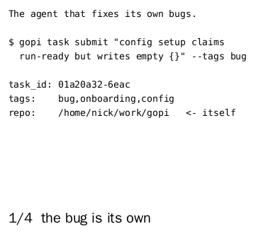

<!-- doc-class: normative -->

<div align="center">

# gopi

**一个 agent harness —— AI 编程 agent 跑在上面的那一层，而且它自己会记账。**

**这个项目是一个 agent 写的。** 它几乎每一行 —— 这个仓库里 50 万行 Go ——
都是 gopi 自己写的，历时四个月。它的发起人不写 Go：他把工作立成账本里的行，
读回结果，掌握方向；代码由 worker 交上来。

```bash
git ls-files '*.go' | xargs wc -l | tail -1     # 这个仓库，今天
```

这不是杂技，它是后面每一段的证据。

`scripts/gopi-stats.sh` 把其余的量出来，实时、直接读 git 对象库 —— 里面没有一个硬编码数字。
在完整的研发仓里（这个发布仓是它的一个筛选子集）：

```
1,196 个生产文件 · 532,870 行 · 13,161 个函数 · 100 个包
2,571 个测试文件 · 746,839 行测试 · 测试:生产 比值 1.40
2,989 个 markdown 文件 · 587,918 行文档
```

最后那个比值值得多看一眼：**测试代码比生产代码还多 40%** —— 这才是其余一切说得通的原因。
检查 agent 的活的是测试，不是一个人逐行读 diff。

**默认全放权。** 大多数编程 agent 每一步都要停下来问你 —— 这个改动批不批准、
这条命令跑不跑。gopi 反过来：一个会话执行命令、改文件、提交、推送，都不请示。
因为一个每步都要点头的监工，就没法再看别的东西了。仍然必须由人决定的只有三类，
而且刻意写得很窄：不可逆的 git ref 移动、对不属于自己的进程发信号、破坏性系统操作。
其余都是 agent 自己的事 —— 而写出这个仓库的 agent，就是这套安排行得通的证据。

*Harness*（智能体运行框架）这个词很多人不认识，所以放在第一句。市面上大多数
"AI 应用"**不是** harness：它们是跑在 harness 之上的应用。gopi 是 harness 本体 ——
一个完整的编程 agent（对话、文件工具、记忆、可续跑的会话），**外加**只有 harness
才需要、应用不需要的那套机制：工作账本、派发、每个 worker 一个独立 clone、自合并交付。

你的编程 agent 在上下文被压缩的那一刻就忘了这件事。
gopi 把它记成**账本里的一行**，交给一个在独立 clone 里跑的 worker，
做完之后把经验留下来 —— 全部装在一个零运行时依赖的静态 Go 二进制里。

多个 agent 也可以同时做同一件事：**任何会话都能给任何别的会话发消息**，
同机或跨机，而且每个都能拒绝对方的证据。这个 README 里的错误就是这么被抓出来的。

[](LICENSE)
[](https://go.dev/dl/)
[](#为什么是单二进制)

[English](README.md) · 简体中文 · [安装](INSTALL.md) · [命令](COMMANDS.md) · [配置](CONFIG.md)

</div>


*上面每一帧都是一个真实命令的真实输出 —— 由 `gopi tool text2img` 渲染成 PNG、
由 `gopi tool gif` 拼成 GIF。两个都是这个二进制自己。整条链没有 ffmpeg、没有
ImageMagick（[复现配方](docs/quickstart.md)）。*

---

## 30 秒上手

```bash
git clone https://github.com/nickhuang99/gopi.git && cd gopi
make build
./bin/gopi --version
```

然后：

```bash
./bin/gopi config setup      # 幂等：缺什么补什么，已有的一个字都不动
./bin/gopi chat              # 开始对话
```

构建需要 **Go 1.24+**，跟模型说话需要**一个 API key**。
别的都不要 —— 不要 Node、不要 Python、不要 Docker、不要 `node_modules`。

---

## 它和别的 agent 哪里不一样

大多数 agent harness 回答的是「怎么跟一个会改文件的模型聊天」。
gopi 回答的是另一个问题：**一个人怎么在没有雇员的情况下运营一家软件公司。**
问题不一样，核心对象就不一样。

### 1. 工作单位是账本里的一行，不是一段对话

主流 agent 里，你说完、上下文压缩、这件事就不留痕迹了。在 gopi 里，一件工作是一**行**：
有 id、有状态机、有认领人、有交付分支、有一个几个月后还能翻出来读的会话目录。

```bash
$ gopi task submit "把 config 加载路径从相对改成绝对" --tags refactor
Task queued: 01a201ec-3cbc-7af2-ace5-e554fbb102dc (status=pending, source=agent, tags=refactor)
```

这一行能挺过崩溃、重启和 `rm -rf ~/.gopi`。事后可以问它任何事：

```bash
gopi task show 01a201ec-3cbc-7af2-ace5-e554fbb102dc   # 状态、认领人、父行、payload 修订史、交付证据
gopi task list --status pending                        # 什么能被认领，以及某行为什么被挡住
```

**失败不是终点。** `gopi worker --resume <id>` 在同一行、同一目录里接着跑，checkpoint 追加；
`gopi task clone <id>` 给一个干净房间，从头重做。该用哪个由 `gopi task status <id>` 的**退出码**
决定，不由你对当时情况的记忆决定。

### 2. worker 在自己的 clone 里跑，自己合并

整个系统存在的意义是：**持有上下文的那个不是你。**
`gopi worker` 认领一行、把仓库 clone 到私有目录、干活、构建、拉集成分支、
**自己解决冲突**、推送。然后这一行带着证据。

```bash
$ gopi worker 01a201ec-3cbc-7af2-ace5-e554fbb102dc
# ...在隔离环境里跑完...
clone-channel: attempt 1/M: push accepted
```

交不出去的运行会点名说清楚（`clone channel: delivery did not land — …`），**不会沉默**。

### 3. 记忆是一个子系统，不是外挂一个向量库

三层，全部可查、可搜、可投票：

| 层 | 装什么 | 怎么问 |
|---|---|---|
| 蒸馏 | 一行一条可复用经验：主题 / 问题 / 答案 / 关键词 | `gopi memory search "为什么 build 会红"` |
| 流程 | 可复用工作流，按步骤排列 | `gopi memory search "<任务>"` |
| 会话索引 | 过去每一次运行的每一轮，各一条可搜笔记 | `gopi session notes "<query>"` |

检索是**自动的** —— 相关的经验在你问之前就被预取进提示词。
反馈会推动置信度，所以差的沉下去、好的浮上来。

### 4. 多个 agent 能一起做同一件事，而且能互相纠正

如果只能留一条，我们留这条。Claude Code 也有这个能力，而且能跨机器；对我们真正要紧的差别在 peer 是什么 ——
在那边它是同一个用户的另一个会话，在这里 peer **是账本行上的一个 dispatched worker**，一条消息可以改变已经跑起来的工作。

一个 gopi 会话可以给**另一个 agent 的会话**发消息，同机或跨机，一次工具调用或一条命令：

```bash
$ gopi notify --session <另一个会话的 id> --message "$(cat findings.md)"
delivered: 1 message into .../messages/inbox.jsonl
```

消息落进对方自己的收件箱，在它的**下一个回合边界**被取走：正在跑的一轮不会被打断，
空闲的会话会自己醒来读。收方可以用同一条命令回信，于是两个 agent 之间直接对话，
不需要经过你。

```bash
gopi notify --peer hp --session <id> --message "..."   # 跨主机，走已声明的 ssh 腿
```

**它不是聊天室。** 每个会话有自己的任务清单、自己的账本行、自己的 git ground。
过线的是**证据** —— 一条命令和它的输出 —— 而收方**有权不认**。这正是重点：
第二双眼睛能说出"你这个测量支撑不了你的结论"。

**实际长什么样。** 在这个项目的一次协作里，两个 agent 在同一份账本上工作了一天，
反复推翻对方：

- 一个报"还有 3 行是旧的分词格式"。另一个把原始行拉出来，证明产生 `3` 的那个判据本身是错的
  —— 正确答案是 **0 行**。前一个结论被撤回。
- 一个立 bug 说"控制台把绝对路径写死了"。另一个证明那串绝对路径来自**报告者自己 echo 里的
  `bash` 波浪号展开**，不是程序输出 —— 源码里那一行用的是 `~`。那条 bug 被作为误报取消。
- 一个判定"2002 行的交付物从没被提交过"。另一个逐文件比对 blob，发现内容**已经落库**，
  只是换了提交哈希（交付通道会 rebase，哈希被重写是设计行为）。结论从"工作丢了"翻成"工作已落地"。

那一天两边都错过，也都在对方错的地方对过。**单个 agent 做不到这件事**：
它自己的上下文里没有任何东西会反对它。

**诚实的边界。** 投递是即时的；**被读到取决于收方走到回合边界**，可能要几分钟。
一个已经卡在循环里的 agent 永远读不到收件箱 —— 这套机制是给正在工作的 agent 补信息，
**不能让一个坏掉的 agent 复活**。跨主机投递需要已声明的 peer 和一条通的 ssh 腿，
缺任何一样都会带原因地报错。

完整例子见 [`examples/session-collaboration/`](examples/session-collaboration/)。

### 5. 它能看屏幕、也能操作屏幕

这不是外挂一个截图工具：是手写的 X11 协议客户端，纯 Go，零 CGO。
捕获 → 读 → 操作 → 验证，每一步都有像素哈希证明它真的变了。

```bash
gopi tool capture --self                    # gopi 自己所在的那个终端，按 pid 解析，不会抓错窗口
gopi tool vision_analyze shot.png   # 这张屏幕说了什么？
gopi tool act move 640 400                  # 操作真实桌面
```

---

## 看它怎么跑

**13 个实跑例子** —— `ls -d examples/*/ | wc -l` 就是那个数，每个目录都收录在
[`examples/README.md`](examples/README.md)。本页链到其中九个；每一个都来自**真实运行**，
输出是原文，不是示意图。

<table>
<tr>
<td width="50%"></td>
<td width="50%"></td>
</tr>
<tr>
<td><b>提交一行，让 worker 去跑</b><br><code>submit</code> → 一个 clone → 一个 worker → 提交回来。<a href="examples/workflow-dispatch/">完整走一遍</a></td>
<td><b>同时做几个项目</b><br>互不相干的行，各自在自己的 clone 里，没有共享工作目录。<a href="examples/parallel-projects/">完整走一遍</a></td>
</tr>
<tr>
<td></td>
<td></td>
</tr>
<tr>
<td><b>两个 agent 互相纠正</b><br>一次真实的收件箱往来——一个 agent 推翻了另一个的结论。<a href="examples/session-collaboration/">完整走一遍</a></td>
<td><b>gopi 开发 gopi</b><br>这个仓库就是它自己的 worker 在自己的账本上写出来的。<a href="examples/self-development/">完整走一遍</a></td>
</tr>
</table>

另外五个，各讲一个机制：

- **[会话回放](examples/session-replay/)** —— 把跑完的会话原样流回来，一个字节不差，不碰模型。
- **[Token 与缓存](examples/token-and-cache/)** —— 一次运行花了多少，以及为什么这个数不是估算。
- **[失败后接着跑](examples/resume-after-failure/)** —— 一次失败判的是"这一次尝试"，不是"这件活"。
- **[语音输入](examples/voice-input/)** —— 四个引擎一个命令；真实数字，包括不好看的那些。
- **[不信「完成了」](examples/worker-false-completion/)** —— 状态是这一轮自己说的话，不是测量；三种「做完了」其实没做完。

---

## gopi 与其他主流 harness

| | gopi | Crush | Claude Code | Pi | Codex CLI |
|---|---|---|---|---|---|
| **运行时依赖** | 无（静态二进制） | Go 二进制 | Node.js 18+ | Node.js 22.19+ | 见其 README |
| **工作单位** | 账本行，跨会话存活 | 会话 | 会话 | 会话 | 会话 |
| **上下文压缩后工作还在吗** | 在 —— 它就是一条数据库记录 | 不在 | 不在 | 不在 | 不在 |
| **无人值守派发** | `gopi worker` 认领并跑完 | README 未提及 | README 未提及 | print/JSON 模式 | README 未提及 |
| **agent 之间通信** | 任何会话都能给任何别的会话发消息，同机或跨机；收方在下一个回合边界取走，且可以拒绝发送方的证据 | 仅单向 —— MCP **Channels** 把事件**推进**会话，没有会话寻址另一个会话 | 有 —— **cross-session messaging**（`ListAgents` / `SendMessage`，需 v2.1.224+，含跨机器）与 **agent teams**（实验性）；peer 的消息被当作输入而非权威 | 无 —— 它自己的 README：「skips features like sub-agents」 | 仅 subagent —— 父 agent 并行派生、子 agent 把摘要回给主线程 |
| **每个任务的隔离** | 独立 git clone，自动回收 | README 未提及 | README 未提及 | README 未提及 | sandbox |
| **长期记忆** | 三层 + FTS + 反馈 + 自动预取 | README 未提及 | README 未提及 | README 未提及 | README 未提及 |
| **桌面控制** | 纯 Go X11，无依赖 | README 未提及 | README 未提及 | README 未提及 | README 未提及 |
| **多模型** | DeepSeek（自带 key），Anthropic/OpenAI 兼容经 proxy | 多家 | Anthropic | 多家 | OpenAI |

<sub>agent 通信这一行是**实测**的，不是从各家的 README 里读出来的（2026-11-24 核查，来源点名）：
Claude Code —— [code.claude.com/docs/en/cross-session-messaging](https://code.claude.com/docs/en/cross-session-messaging)
与 [code.claude.com/docs/en/agent-teams](https://code.claude.com/docs/en/agent-teams)（它自己的 README 一个字没提）；
Codex —— [developers.openai.com/codex/subagents](https://developers.openai.com/codex/subagents)；
Crush —— 其 README 的 Channels 一节；Pi —— 其 README。
这一行**不**声称 gopi 的机制更好：Claude Code 能到达别的会话**也能跨机器**，且把 peer 的消息当输入而非权威 ——
这条边界 gopi 没有划。gopi 在这里声称的更窄、也可检验：peer 可以是**账本行上的 dispatched worker**、
消息在收方**未运行**时仍然 durable、发送方的证据**可以被拒绝并重新推导**而不是照办。</sub>

<sub>「README 未提及」就是这个意思：本表写作时，那个字符串没有出现在该项目自己的 README 里。
它**不是**「对方没有这个能力」的断言 —— 其中大多数通过插件能做到更多。请把每一行读成
「各家选择宣传什么」，绝不要当成功能审计。数字与引文均取自各项目自己的 README，
依赖本表之前请自行复核。</sub>

**gopi 弱在哪里，诚实写出来：** 没有 MCP、只有 Linux 发布包（macOS 能交叉编译但没真跑过）、
开箱只有一家模型、没有 npm/brew 包。见[§ 边界](#边界)。

---

## 安装

挑适合你的一种。

### 下载预编译二进制（不需要工具链）

每个 release 都带一个可直接运行的二进制，由 GitHub Actions 构建：

**[→ 最新 release](https://github.com/nickhuang99/gopi/releases/latest)**

| 平台 | 文件 |
|---|---|
| Linux x86-64 | `gopi_<version>_linux_amd64` |
| Linux ARM64 | `gopi_<version>_linux_arm64` |

```bash
VER=v0.5.2
curl -fLO "https://github.com/nickhuang99/gopi/releases/download/${VER}/gopi_${VER}_linux_amd64"
curl -fLO "https://github.com/nickhuang99/gopi/releases/download/${VER}/gopi_${VER}_linux_amd64.sha256"
sha256sum -c "gopi_${VER}_linux_amd64.sha256"
chmod +x "gopi_${VER}_linux_amd64"
./gopi_${VER}_linux_amd64 --version
```

然后放进 `PATH`：

```bash
mv gopi_${VER}_linux_amd64 ~/.local/bin/gopi
```

**发布包只带 Linux，但 macOS 现在能交叉编译了。** darwin 的平台拆分已落地（2026-11-23）：
darwin 的 `syscall.Fsid` 字段叫 `Val`（linux 叫 `X__val`）、`Statfs_t.Type`/`Bsize` 是 `uint32`、
`Stat_t` 的时间戳叫 `Ctimespec`/`Mtimespec`、`SysProcAttr` **没有** `Pdeathsig` 字段 ——
每一处现在都在各自的平台文件后面。实测于该版本：`GOOS=darwin GOARCH=arm64` 产出一个可用的
`Mach-O 64-bit arm64 executable`（72 MB），linux 仍然照常构建。

**Windows 构建不了**，而且短期内也不会 —— 缺口不是语法。`syscall.RLIMIT_AS` / `Rlimit` /
`Getrlimit`（rlimit）、`O_NOFOLLOW`、以及一批 statfs 调用点在 Windows 上没有对应物，
每一处都需要真机制而不是改个字段名。发布流只发布实测能构建的两个目标，而不是三个里有一个永远红。
见[§ 边界](#边界)。

**darwin 是「编译通过」，不是「跑过」** —— 手上没有 macOS 机器，所以请当作「它能构建」而不是
「它能用」。已知三处降级，每处都在自己的调用点上写明：`Pdeathsig` 不存在（被 SIGKILL 的父进程
留下的 filmed 子进程不会被内核回收）、pty 文本抓取不可用（要 `TIOCPTYGNAME` 加
`grantpt`/`unlockpt`，属 libc，而本二进制是 `CGO_ENABLED=0`）、`cgroupscope` 依赖的
`/proc/self/cgroup` 在 darwin 没有对应物。

### 先装 Go —— 克隆之前请读这一段

gopi 需要 **Go 1.24.0 或更新**，这是硬性要求，不是偏好。`go.mod` 声明 `go 1.24.0`，
而且**四个直接依赖在各自的 `go.mod` 里声明了同样的下界** —— `modernc.org/sqlite v1.44.0`、
`golang.org/x/sys v0.37.0`、`github.com/charmbracelet/bubbletea v1.3.10`、
`github.com/go-ego/gse v1.1.0`。旧工具链会直接拒绝构建，没有绕过的路。

```bash
go version          # 必须打印 go1.24.0 或更高
```

**不要用发行版的包管理器装。** Ubuntu 22.04 的候选版本是 `2:1.18~0ubuntu2` —— 低了六个
版本 —— 所以 `sudo apt install golang-go` 装出来的工具链根本编不动这棵树。
（实测：`apt-cache policy golang-go`。）请装上游工具链：

**Ubuntu / 任意 x86-64 Linux**

```bash
curl -fLO https://go.dev/dl/go1.24.0.linux-amd64.tar.gz
sudo rm -rf /usr/local/go && sudo tar -C /usr/local -xzf go1.24.0.linux-amd64.tar.gz
export PATH=$PATH:/usr/local/go/bin     # 同时把这行写进 ~/.bashrc 或 ~/.profile
go version                              # go1.24.0 linux/amd64
```

ARM64 把两条命令里的 `linux-amd64` 换成 `linux-arm64`。

**macOS** —— Homebrew（`brew install go`）或 <https://go.dev/dl/> 的官方 `.pkg`，两者都是
当前版本。用 `go version` 确认。

**Windows** —— <https://go.dev/dl/> 的官方 MSI 安装包。在新终端里用 `go version` 确认。

> 如果你的 `go version` 偏旧、以为 Go 会自己升级：它不会。`GOTOOLCHAIN=local` 是很多环境里的
> 默认值，而 `go.mod` 里比工具链更新的 `go` 行是硬构建错误，不是自动升级的触发条件。

### 从源码

```bash
go version                         # 必须 1.24.0 或更新 —— 硬性要求
git clone https://github.com/nickhuang99/gopi.git
cd gopi
make build                         # → ./bin/gopi
./bin/gopi --version
```

放进 `PATH`：

```bash
make install                        # → $(go env GOPATH)/bin/gopi
make install PREFIX=/usr/local/bin  # 或者一个已经在 PATH 里的地方
```

### 自带 key

gopi **不附带任何凭据**。它围绕 **DeepSeek** 构建；`settings.example.json` 里的模型名是占位符，
换成你自己从 <https://platform.deepseek.com/> 拿的 key。

```bash
cp settings.example.json ~/.gopi/settings.json
$EDITOR ~/.gopi/settings.json       # 替换 "PUT-YOUR-OWN-DEEPSEEK-KEY-HERE"
```

没有 key gopi 照样能启动，所有不调用模型的命令照样能用 —— 它会告诉你缺哪个 key，
而不是静默失败。

### 语音输入（可选，而且它**不是** DeepSeek）

听写是一套**独立子系统，有自己的账号、自己的账单**。两个引擎，都不是 LLM 供应商：

| 引擎 | 磁盘上的权重 | 音频是否离开本机 | 你需要什么 |
|---|---|---|---|
| `--engine doubao`（默认） | **0 B** —— 什么都不用下载 | **是**，会上传 | 火山引擎（字节）SAUC 账号：app id + access token |
| `--engine local` | **磁盘 1.7 GB**（每次运行加载 910 MB） | **否** | 那些权重文件，外加一个约 6 MB 的运行时，得自己编译 |

**云端引擎。** 语音转文字走的是火山引擎 SAUC（豆包大模型 ASR），**不是 DeepSeek**。
不同厂商、不同控制台、不同发票。`settings.example.json` 里注释掉的 `_voice_optional`
段落写了形状 —— endpoint `wss://openspeech.bytedance.com/api/v3/sauc/bigmodel_async`，
resource id `vol.seedasr.sauc.duration`。**不填那两个 key 什么都不会坏**：调用语音路径时
它报「未配置」，其余命令一律不受影响。

**本地引擎。** Fun-ASR-Nano（SAN-M 编码器 + Qwen3-0.6B），通过官方 FunASR 的
**llama.cpp** 运行时跑在你自己的 CPU 上 —— 磁盘上 1.7 GB 权重（每次运行加载 910 MB）
永不出磁盘，音频永不出本机。
同一段音频、同一个打分器，实测：

```
Fun-ASR-Nano（本地）   CER 1.58%   0.32x 实时
whisper-small          CER 5.14%   0.95x 实时
whisper-medium         CER 2.77%   3.4x  实时
```

精度比 whisper-medium 还好，算力只要它的十分之一。代价是诚实的，而且**是部署代价，
不是质量代价**：你得自己弄到权重（磁盘 1.7 GB）、自己编译一个 C++ 运行时。gopi 既不分发、
也不替你下载。

gopi 按顺序找本地部署：

```
<gopi 配置目录>/voice          即 ~/.gopi/voice   ← 优先
$HOME/work/funasr-models                        ← 旧位置，只读
```

两处都没有时它**不加载任何东西**，而是点名缺哪个文件、告诉你该放进哪个目录，
并告诉你怎样完全不需要它（`--engine doubao`）。接近 2 GB 的权重加一个外来的运行时，
**没装是正常的**，gopi 就是这么对待它的 —— 而不是当成装坏了。

**如果你根本不需要听写，这一整节可以跳过。** gopi 里没有别的东西碰它。
细节见 `devdoc/doubao-audio-endpoint-credential-config.md` 与
`devdoc/audio-engine-config-surface.md`。

### 验证安装

```bash
gopi config setup     # 幂等准备
gopi config show      # 实际生效的配置，以及每一个值是被哪个通道决定的
gopi chat             # 开始对话
```

`gopi config show` 打印的是**解析后的结果**，不是文件内容，而且每个值旁边写着哪个通道赢了
（命令行 flag / 环境变量 / settings.json / 默认值）。当行为和你在文件里写的对不上时，
读那一页。

**平台：Ubuntu 22.04 LTS、x86-64、Go 1.24.x** —— 唯一跑过的组合。
macOS、Windows、ARM、其他发行版都没测过；诚实清单在 [`INSTALL.md` §6](INSTALL.md)。

---

## 它能做什么

顶层动词是 **13 个**，这个数是数出来的，不是记出来的：`gopi -h` 的 `Commands` 块里
点了 12 个词（`chat`、`config`、`memory`、`notify`、`screen`、`screen-replay`、
`session`、`task`、`tool`、`ui_state`、`web`、`worker`），`Usage` 块点了第十三个
`gopi version`。本页按**你想干什么**分组，而不是按 CLI 碰巧怎么组织 —— `gopi -h`
才是完整清单，也是"某个命令到底存不存在"的唯一权威。这个唯一的门下面挂着
**18 个 `gopi tool` 命令**（`gopi tool -h`：15 个 direct + 3 个 grouped）。

下面每一条命令都**真的能跑**，没有一个是示意。

同一个命令可能出现在两个标题下：分组按的是**你的目的**，一个命令可以服务两个目的。

### 1. 和一个 agent 对话

| 我想 | 命令 |
|---|---|
| 交互式地用 | `gopi chat` |
| 一次干完一件小事，不进循环 | `gopi chat --once -p "把这个函数的错误分支补上"` |
| 用浏览器而不是终端 | `gopi web --addr 127.0.0.1:8080` |
| 把控制台画的东西读成单元格网格 | `gopi ui_state --json` |

### 2. 派活，并盯着它

| 我想 | 命令 |
|---|---|
| 交出一件活得比这次对话更久 | `gopi task submit "<这件事>"` |
| 看某件活现在走到哪一步 | `gopi task show <id>` |
| 它背后那个进程真的还活着吗 | `gopi task status <id>` |
| 找没人认领的活 | `gopi task list --status pending` |
| 无人值守地消费队列 | `gopi worker` |
| 在账本里搜过去干过的活 | `gopi task search "<你记得的关键词>"` |
| 收掉一件已完成的活，保留它的记录 | `gopi task archive <id>` |
| 清理已完成任务的工作目录 | `gopi task sweep-worktrees` |

### 3. 记住，以及查东西

| 我想 | 命令 |
|---|---|
| 让它记住一条可复用经验 | `gopi memory store --topic "..." --question "..." --answer "..."` |
| 问它以前是否碰到过 | `gopi memory search "为什么 build 会红"` |
| 给召回的经验投票：有用 / 没用 | `gopi memory feedback <id> --useful` |
| 换模型后重算一行的索引 | `gopi memory backfill-tokens` |
| 找某个符号的**定义** | `gopi tool code-search <Symbol>` |
| 全文搜索代码树 | `gopi tool keyword_search "<pattern>"` |
| 查某一行是谁写的、为什么 | 会话内 `git_blame` 工具；命令行 `git blame` |

### 4. 证明当时到底发生了什么

这是大多数 harness 没有的那一组，也是那 13 个动词里有两个存在的理由。

| 我想 | 命令 |
|---|---|
| 列出跑过的会话 | `gopi session list` |
| 一轮一轮读一次运行 | `gopi session log --last` |
| 发给模型的原始字节 | `gopi session raw --last` |
| 花了多少，含命中率 | `gopi session stats --last` |
| 接着一段被打断的对话 | `gopi --session <id>` |
| 回放一段录下来的屏幕 | `gopi screen replay <id>` |
| 逐字节对比两份录制 | `gopi screen-replay --verify A B` |
| 我正在跑的是哪个构建？ | `gopi version` |
| 给另一个会话投递消息 | `gopi notify --session <id> --message "..."` |
| 读任务事件流 | `gopi notify events` |

### 5. 让它看得见屏幕，并在上面动手

| 我想 | 命令 |
|---|---|
| 捕获当前桌面 | `gopi tool capture --screen --out s.png` |
| 捕获它自己所在的那个终端 | `gopi tool capture --self` |
| 操作桌面 | `gopi tool act move 100 100` |
| 读出图片里是什么 | `gopi tool vision_analyze <image>` |
| 在一张已有 PNG 上画标记 | `gopi tool annotate in.png --out marked.png --mark "rect:200x40+14+13::fixed"` |
| 给网页截图（无头，不碰真实屏幕） | `gopi tool shot --url https://example.com` |
| 把文本渲染成图片（支持中日韩） | `gopi tool text2img <input.txt>` |
| 把 PNG 帧拼成一个动画 GIF | `gopi tool gif --frames a.png,b.png,c.png --out out.gif` |
| 转写音频 | `gopi tool voice_input <audio>` |
| 搜索 / 抓取网页 | `gopi tool web search "<查询>"` |

### 6. 配置它、数清它、关住它

| 我想 | 命令 |
|---|---|
| 看**实际生效**的配置，以及每个值是哪条通道定的 | `gopi config show` |
| 测量这台机器并描述它的环境 | `gopi config env` |
| 把一台新机器准备好 | `gopi config setup` |
| 给 shell 装补全 | `gopi config completion bash` |
| 所有环境变量，一张表 | `gopi --help-env` |
| 任意动词的用法 | `gopi <verb> -h` |
| 拿 token 数和 provider 自己报的数对照 | `gopi tool tokens --session <session-id>` |
| 在私有 profile 里跑一次，不污染主账本 | `gopi tool sandbox run --label probe -- <cmd>` |
| 看临时目录里哪些可以回收 | `gopi tool scratch-gc --dry-run` |
| 把一个 OpenAI 上游当 Anthropic 端点提供出去 | `gopi tool proxy --upstream openai` |

`tool` 里有两个是**故意内部化**的 —— `gopi tool -h` 正好把这两个标成 `(internal)`：
`scratch-gc` 和 `ledger-window`。`screen_capture` 是 `capture` 的整屏拼写，
`text2img-verify` 用来检查渲染器自己的像素精度。它们都是真的、都能跑；它们的输出是
本仓库自己那些 gate 的契约，所以脚本可以依赖它，人不必。把它们列在这里而不是藏起来，
是因为一个没有门的"能力"只能靠单元测试来测。

---


## 边界

gopi **不是**「什么都能」。下面这些是刻意的取舍，不是待办事项：

- **没有 MCP。** 有一个插件树，但没有 Model Context Protocol 客户端。加 MCP 意味着
  一个新协议加一个常驻连接，这与「零依赖、单二进制」相冲突。**是在等裁决，不是在等实现。**
- **不提供在线安装脚本。** 没有 `curl … | sh`。一个从网络上下来、用你的权限执行的脚本，
  是一个不该轻易引入的依赖。
- **它不会替你在别人的机器上装软件。** 取证、探测、验证都允许；
  「装一个第三方 agent 好让某个测试能跑一次」是明确禁止的。
- **不承诺在设备压力下的延迟。** gopi 不为测量什么而制造负载，所以对争用下的性能不作任何声称。
- **平台收敛到两个，但只有一个真跑过。** 唯一**跑过**的组合是 Linux x86-64。Linux ARM64 会构建并发布
  —— 已实测能编译、能带上版本戳，但**没有**实测能执行，因为 CI runner 是 amd64 且没配模拟器。
  macOS 自 2026-11-23 起**能交叉编译**（darwin 的平台拆分：`Fsid.Val` vs `X__val`、`Statfs_t.Type`
  的符号性、`Ctimespec`/`Mtimespec`、缺失的 `Pdeathsig`），实测产出可用的 arm64 Mach-O ——
  但**从未在 macOS 上运行过一次**，所以它是「能构建」而非「能用」。
  Windows 仍然**编译不过**，且缺口不在语法：rlimit、`O_NOFOLLOW`、一批 statfs 调用点在
  Windows 上没有对应物，需要真机制。
- **这个公开导出仓不带测试套件。** `make test` 跑的是 `go build ./...` 加 `go vet ./...` ——
  在纯产品代码上唯一有意义的两项检查。`_test.go` 与 `internal/standards/` 留在了私有树里。
  **这些文档里引用的任何 `go test` 命令，点名的测试都不在本仓库中：它会打印
  `no tests to run` 并退出 0。那是空转的绿灯，不是通过的检查。** 请用跑二进制的方式验证行为。

---

## 文档

| 你想知道 | 去哪看 |
|---|---|
| **在一台新机器上装起来，以及到底需要什么** | [`INSTALL.md`](INSTALL.md) |
| **每一个 CLI 动词的完整用法** | [`COMMANDS.md`](COMMANDS.md) —— 421 行，按动词排列 |
| **每一个配置键的默认值、优先级、以及读它的那行代码** | [`CONFIG.md`](CONFIG.md) —— 1649 行 |
| **某个子系统的正式说明** | [`man/`](man/) —— 14 页 |
| **代码为什么长这样** | [`PROJECT.md`](PROJECT.md) —— 37 条工程约束 |
| **设计决策背后的实测** | [`devdoc/`](devdoc/) —— 每份文档第 1 行声明自己的 doc-class |
| **改了什么** | [`CHANGELOG.md`](CHANGELOG.md) |

> 上表中的数字来自 `wc -l <file>` 与 `ls man/*.md | wc -l`。请自行重跑；
> 这个导出仓不带任何能发现数字过期的门。

---

## 状态

`v0.5.2` —— 第一个公开版本。在活跃开发中：接口会变，但每一次变化都记在 `CHANGELOG.md`。

```bash
$ ./bin/gopi --version
v0.5.2
go: go1.24.0
platform: linux/amd64
revision: <你构建时那个提交>
```

`revision` 在构建时写死，所以它指的是**你的**二进制来自哪个提交 —— 这就是它不写在这份文档里的原因。

## 许可证

MIT —— 见 [`LICENSE`](LICENSE)。
