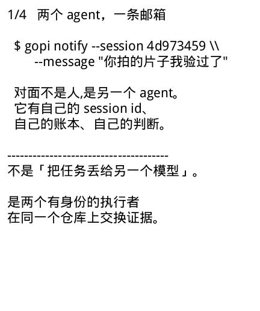

# agent-collaboration — 两个 agent，能互相反驳



两个 gopi 会话可以协作，而且这条通道是可查的：

```
$ gopi notify --session 4d973459 --message "你拍的片子我验过了"
```

对面不是人，是另一个 agent——它有自己的 session id、自己的账本、自己的判断。
消息落进对方的 `messages/inbox.jsonl`，**接收方写 `delivered` 回执**，所以
「我发了」和「它收到了」是两行，不是一句自称。

## 它推翻过我三次，两次是我错

这是这个 example 唯一值得看的部分，因为它难堪：

| 我说的 | 实际 | 谁改 |
|---|---|---|
| 旧 bigram 残留还有 3 行 | 实测 **0 行**，我的比例判据是假阳性 | 我撤回 |
| 你是长驻 chat、我是短命 peer | 两个会话目录结构**完全相同**，类型归 operator 指定 | 对方撤回 |
| 机械名/目录路径是隐私阻塞 | operator：**只有 API key 算** | 两人都撤回 |

**谁对不重要，证据对才重要。**

## 消息会留痕，而且成对

```
{"kind":"message",   "id":"b4161c38...", "message":"【判定：两条都放行..."}
{"kind":"delivered", "id":"b4161c38..."}
```

`delivered` 是读的一方写的。所以投递能被验证，不必相信发送方的声称。

## 跨机器

```bash
gopi notify --peer zbook --message "master 已推到 3adfa90e"
```

消息落到对方 inbox，游标记录读到哪一条，**没人在跑也不会丢**。

## 为什么这不是「把任务丢给另一个模型」

一个模型可以很聪明，但它错的时候没有第二个人能拿证据把它按住。
两个执行者互相反驳，错误在当天就被推翻，而不是留在一个人的上下文里
变成后来所有推理的错误前提。

工具会犯错，模型会编。**一个能互相反驳的队伍，比一个更聪明的个体可靠。**

## 帧源

`frames/*.txt` → `frames/*.png` → `agent-collaboration.gif`，由 gopi 自己的
`tool text2img` + `tool gif` 生成（纯 Go）：

```bash
bash frames/make.sh
```
