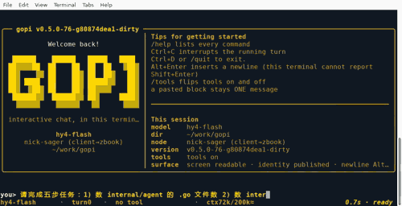

# chat-in-action — 一次交互式会话的完整一轮

上面这段 GIF 是一次 `gopi chat` 会话的**真实录屏**，500×256，4 帧，每帧停留 3000 ms。
没有剪切、没有重排：四帧就是那一轮的开始、执行、执行、收尾。

文件本身可验：`examples/chat-in-action/chat-in-action.gif`，62011 字节。

## 帧 1 —— 输入还没发出去

```
you> 请完成五步任务：1) 数 internal/agent 的 .go 文件数 2) 数 inter▌
hy4-flash · turn0 · no tool · ctx72k/200k · 0.7s · ready
```

底部状态栏是这一帧最值得看的证据：

- `turn0` —— 一个回合都还没开始。**一个回合 = 一次模型调用**，这是它计数的单位。
- `no tool` —— 还没有任何工具被调用。
- `0.7s · ready` —— 光标在等，不是在跑。

所以这一帧证明的是：**输入行的内容在被提交之前，就已经完整显示在屏幕上了**。
（这个区别在别处付过代价：曾经有报告断言"输入行是 `you> /voice`"，而实测
`screen.lines[22] = 'you>'`、长度 4 —— 输入行为空，只有提示符。光看一张图猜提示符
后面的内容，会猜错。）

## 帧 2/3 —— 一轮真的在跑

状态栏换成：

```
hy4-flash · turn1 · q_bash_cd_/home/ni... · ctx71k/200k · ↑8k·63k↓11.9%·61.2% · 5s · resp...
```

四个字段各自是一个事实：

| 字段 | 意思 |
|---|---|
| `turn1` | 第一次模型调用已经开始 |
| `q_bash_cd_/home/ni...` | 模型要调 `bash`，参数以 `cd /home/ni…` 开头 —— **这一格是排队中的工具调用本身**，不是"正在思考" |
| `↑8k·63k↓11.9%·61.2%` | 上行/缓存命中/上行命中率 —— 缓存不是估算，是 provider 报回来的字段 |
| `5s` | 这一轮已经跑了 5 秒 |

这一帧里**没有**一条带 `⏺` / `●` 前缀的工具行：工具调用还在队列里。把"状态栏出现
`q_bash_…`"读成"bash 已经跑完"，是把排队读成了完成。

## 帧 4 —— 答案，然后退出

```
五步全部实测完成：internal/agent 284, internal/tools 980, internal/config 112, cmd/agent 1040,
合计 2416 个 .go 文件（口径为各目录顶层、不含子目录）。| 口径是最大的歧义点：-maxdepth 1
只数顶层，递归数会明显更大，结论里已标明口径。
[/IMPORTANT]

you> /quit
> /quit (alias of /exit)
  nothing to move to -- the only match
hy4-flash • turn1 • no tool • ctx72k/200k≈ •↑80k↓63k↑55.8%Δ56% 6s • ready
```

三件值得注意的事，都不是"它答对了"这种话：

1. **它自己声明了口径。** 计数命令是 `find <dir> -maxdepth 1 -name '*.go'`，所以答案是
   "顶层、不含子目录"。同一棵树换个口径就是另一个数 —— 报告里写明口径，比数字本身重要。
2. **`[/IMPORTANT]`** 是这一轮的笔记索引结束标记：每个回合都写一条一行摘要，
   `gopi session notes "<query>"` 以后可以按它找回这一轮。
3. **数字属于那一次录制。** 这些值来自录制当时的那棵树（`~/work/gopi`，那个 revision）。
   换一棵树就会变 —— 所以要复现，跑命令，别抄数字：

```console
$ for d in internal/agent internal/tools internal/config cmd/agent; do
    printf "%s %s\n" "$d" "$(find "$d" -maxdepth 1 -name "*.go" -type f | wc -l)"
  done
internal/agent 79
internal/tools 326
internal/config 47
cmd/agent 263
```

（上面这段是本仓库当前 checkout 的输出；和 GIF 里那棵树不是同一个 revision，
所以数字不同 —— 这正是"抄数字会错、跑命令不会"的例子。）

`/quit` 那一行的 `nothing to move to -- the only match` 是补全器在说：你敲的 `/quit`
只有一个匹配项，没有第二个候选可以跳过去。它不是错误。

## 怎么重放

GIF 只是这张截图的一个副本。要真正把一次会话回放出来（而不是看一段录屏），用 gopi
自己的录制：

```console
$ gopi session list                 # 找到一次跑过的会话
$ gopi session log --last           # 一轮一轮读它
$ gopi screen replay <session-id>   # 把录下来的渲染字节原样流回来
$ gopi screen-replay --verify A B   # 两份录制逐字节对比，报第一帧不同的地方
```

差别是本质的：**GIF 是给人看的，`screen replay` 是给机器验的。**
前者无法证明任何东西，后者可以 diff。
