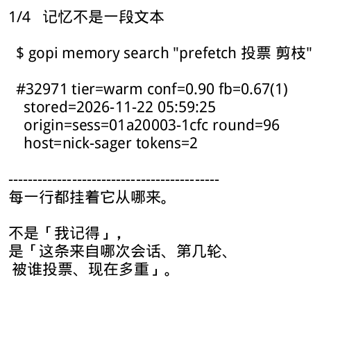

# memory-provenance — 记忆是一本能被审计的账



`CLAUDE.md` / `AGENTS.md` 是一份**手写的文件**，靠人维护：谁写的、什么时候写的、
哪一条已经过时了，文件本身不告诉你。改一条就覆盖一条，被推翻的判断消失了。

gopi 的记忆是一本**账**，每一行都带着它从哪来：

```
$ gopi memory search "prefetch 投票 剪枝"

#32971 tier=warm conf=0.90 fb=0.67(1)
  stored=2026-11-22 05:59:25
  origin=sess=01a20003-1cfc round=96
  host=nick-sager tokens=2
```

`origin=sess=… round=96` 是**出处**——这条结论来自哪一次会话、第几轮。
`conf` 是置信度，`fb=0.67(1)` 是它收到过的投票。这不是元数据装饰，是**可推翻性**：

> 两条记忆互相矛盾时，两条都留着并标上出处，而不是悄悄用新的盖掉旧的。

## 投票决定了什么

注入到上下文里的记忆，**若没人投票，下一轮就被剪掉**。所以「存进去」不等于「留下了」——
一件被用过的东西会留下，没人认领的只是占预算。

实测 162 次注入中，只有 14 次收到过任何投票，7 次拿到 `useful`。

## 为什么这在长任务里重要

一个 agent 跑几十轮之后，它「以为」的东西和它「测量过」的东西会混在一起。
账本的价值在于事后能问：**这条结论当时是凭什么下的？**

```
$ gopi memory search "为什么我的修复没生效"
  → 这条来自哪一轮 / 当时谁推翻了谁 / 现在还有多可信
```

## 自己复现

```bash
gopi memory search "prefetch"
gopi memory feedback --id 1 --rating useful   # 投票
gopi memory update --id 1 --tier cold         # 降级，不删
```

## 帧源

`frames/*.txt` → `frames/*.png` → `memory-provenance.gif`，全部由 gopi 自己的
`tool text2img` 与 `tool gif` 生成（纯 Go，无 ffmpeg / ImageMagick）：

```bash
bash frames/make.sh
```
