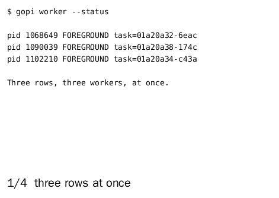

# Example: parallel projects, no merge daemon



Every command and output below was **actually run on a real machine** against a real
ledger. This is not a mock-up.

---

## The problem this answers

Most agent harnesses give you one working directory. Two agents working at once means
two agents editing the same files — and a merge conflict discovered *after* both
sides have committed, when neither can be reasoned about any more.

GoPi removes the shared directory instead of policing it: **every row gets its own
git clone**, and every worker merges itself.

## 1. Three rows, three workers, at once

```console
$ gopi worker --status

gopi worker pid 1068649: FOREGROUND task=01a20a32-6eac (holds no daemon lock)
gopi worker pid 1090039: FOREGROUND task=01a20a38-174c (holds no daemon lock)
gopi worker pid 1102210: FOREGROUND task=01a20a34-c43a (holds no daemon lock)
```

Three rows in flight simultaneously. Note `holds no daemon lock` — these are
foreground workers, not a pool under a supervisor. There is no daemon to keep alive
and nothing that outlives its purpose.

## 2. Different rows declare different repositories

```console
$ gopi task show <each> | grep deliverable.repo

01a20a32  ~/work/gopi
01a20a38  ~/work/sudoku
01a20a34  ~/work/gopi
```

The repository is a **field on the row**, not an ambient setting. One queue drives
work across unrelated projects, and a row carries its own destination with it.

## 3. Each row gets a real clone — not a worktree

```console
$ ls -d ~/workspace/<task-id> ; test -d <dir>/.git && echo CLONE || echo linked

01a20a32  CLONE
01a20a38  CLONE
01a20a34  CLONE
```

`.git` is a **directory** in each, which is the discriminator that matters: a linked
worktree has `.git` as a *file* pointing back at a shared object store. A clone owns
its objects, so nothing one row does can move a ref another row stands on.

That distinction is not pedantry — a linked worktree keeps the integration branch's
namespace open and leaves a `task/<id>` ref that no merge path consumes. GoPi retired
that shape deliberately.

## 4. No merge daemon

```
Each worker commits on master in its own clone,
pulls --rebase, resolves its own conflicts, pushes.

A lost race is paid by re-running,
not by a global queue.
```

A single resident merger serialised every merge in the system and was the bottleneck.
Every worker is now its own merger: work lands in parallel, and a concurrent push that
loses a race costs one re-run.

**The conflict is the worker's, not a reason to branch away from it.** `git pull
--rebase` is where another run's work meets yours; the answer is to read both sides
and land the union.

---

## Why this matters in practice

| One shared directory | A clone per row |
|---|---|
| two agents edit the same file | each edits its own copy |
| conflict found after both commit | conflict met at rebase, while context is live |
| one dirty tree blocks everyone | a dirty tree blocks only its own row |
| a merge daemon serialises all work | workers merge in parallel |
| "who changed this?" needs archaeology | the row's clone holds the whole history |

---

## Reproducing this GIF

Frames are real command output pasted into text files, rendered by gopi's own tools —
no ffmpeg, no ImageMagick, no Node:

```bash
FONT=/usr/share/fonts/truetype/dejavu/DejaVuSansMono.ttf
./bin/gopi tool text2img f1.pad.txt f1.png --size 13 --cols 64 --lh 20 --lines 14 --font "$FONT"

# every frame must agree, or gopi tool gif refuses to compose
python3 -c "import struct;d=open('f1.png','rb').read(33);print(struct.unpack('>II',d[16:24]))"

./bin/gopi tool gif --frames f1.png,f2.png,f3.png,f4.png --out demo.gif --delay 250 \
    --caption "f1.png=1/4  three rows at once"
```

This GIF is **471x334, 34 KB**, four frames — inside the 500 px ceiling a phone
messaging view accepts. See [`docs/quickstart.md`](../../docs/quickstart.md) for the
full recipe, including why `--font` is not optional.
