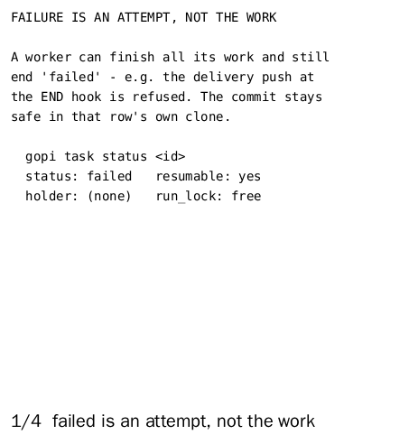

# Example: failing forward — the resume ladder

> Every command below was run on a real row. Outputs are verbatim, not mock-ups.



In a harness where work is a **ledger row**, a failure judges one attempt — not the
whole piece of work. gopi distinguishes "this try failed" from "this work is done",
and gives you an explicit ladder to recover.

## 1. A failed row can still have finished its work

Real case: row `01a20a33` (a README fix). The worker did everything — commit
`49b1e612f` in its own clone, all tests green — but the delivery push at the END hook
was refused. The status told us the work was recoverable:

```console
$ gopi task status 01a20a33-b6db-7cd2-8231-b2787f919587
status:      failed
resumable:   yes
holder:      (none)
run_lock:    free
```

The commit stayed safe in the row's own clone. "failed" meant the delivery attempt
failed, not that the work vanished.

## 2. Ask status first — its **exit code** is the answer

```
Exit: 0 resumable, 1 running (do NOT resume),
      2 ground in use, 3 unverifiable,
      4 no ledger row names the selector,
      5 the row's status forbids a resume (it is finished - gopi task clone).
```

Read the exit **directly**. `gopi task status <id> | grep ...` masks it — the `$?`
becomes grep's, not status's. Redirect to a file, then read both:

```console
$ gopi task status <id> > /tmp/st.txt 2>&1; echo $?
0
```

## 3. The two rungs

**LEVEL 1 — `failed` → resume the SAME row** (same id, same session, same ground;
checkpoint appended):

```console
$ gopi worker --resume <task-id>
```

**LEVEL 2 — `completed`/`verified` → clone** (clean room, NEW session + ground,
briefing carried verbatim):

```console
$ gopi task clone <id> --reason "clean redo"
```

`gopi task reopen` does not exist; `failed → pending` by direct edit is refused by
the state machine. The ladder is resume-or-clone.

## 4. `resumable: yes` means possible, not wise

Here is the judgment call the tools cannot make for you. That real row above was
`resumable: yes` — but the root cause (a clone-channel push aimed at a non-bare repo
with `master` checked out, refusing the push) was still in force. Resuming would have
hit the **exact same wall**. The right move was: fix the channel first, then resume
or reissue. A green `resumable` flag tells you the door is unlocked; it does not tell
you the floor is not on fire. Check **why** it failed before climbing the ladder.

## Animated GIF

`resume-after-failure.gif` — 4 frames, 463x492 px, 49 KB, pure Go (`text2img` +
`gif`). See `frames/make.sh` to reproduce.
