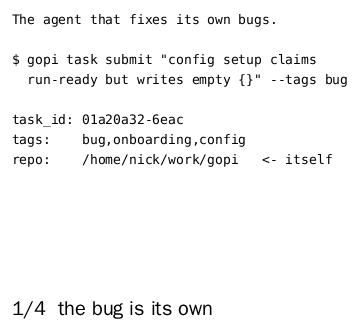

# Example: the agent that fixes its own bugs



Every command and output below was **actually run on a real machine**. This is not a
mock-up.

---

## The problem this answers

An agent that helps you build *other* things is useful. An agent that can only be
repaired by hand is a dependency you cannot delegate — every defect in it becomes an
interruption for whoever owns the machine.

GoPi is built this way: **its own bugs are filed on its own ledger, and a worker
fixes them in a clone of its own source tree.** The thing that schedules the work is
the thing being repaired.

That is what "bootstrap" means here, and it is why the ledger's reliability matters
more than any single feature: every task built on top of it sits on that floor.

## 1. A defect in the product is filed as a row

```console
$ gopi task submit "config setup claims run-ready but writes empty {}" --tags bug

task_id: 01a20a32-6eac
tags:    bug,onboarding,config
repo:    ~/work/gopi        <- gopi itself
priority: 1                 <- derived from the bug tag
```

`priority: 1` is not a judgement call — the `bug` tag sets it. An LLM-reported defect
outranks ordinary work by default, because a defect nobody filed stays live.

## 2. The deliverable IS its own source tree

```console
$ gopi task show 01a20a32-6eac | grep deliverable.repo

deliverable.repo: ~/work/gopi
```

A worker will clone gopi, fix gopi, and publish to gopi. Nothing about the loop is
special-cased: the same claim → run → build → merge path that fixes your project
fixes this one.

## 3. The history is a list of defects found and fixed by runs

```console
$ git log --oneline | grep 'fix('

c3134da84 fix(scratch): 所有目录创建走 suite-run owner 注册者
4de8df44e fix(testutil): SIGKILL 之后真正处理 Wait 的 error
be8eb2758 fix(testutil): MockEnv 不再剥掉死亡管道名字
a404e9754 fix(clone): 「no commit to deliver」写上作用域
937f38b29 fix(test): daemon-leak fixture spawner arms Pdeathsig
```

Each of these started as a row like the one above: a symptom observed on this
machine, a minimal reproduction captured, a defect filed — then a worker that
reproduced it, fixed it, ran the gate and reported what it measured.

The one rule that makes this honest: **a fix is not "done" because the code compiles
and the suite passes.** The surface the change touched has to be executed for real,
with real arguments, and its output reported. A change that no surface ever exercised
has never been tested.

## 4. The recursion is the point

```
   a defect in gopi
        ↓  filed as a row
   a worker claims it
        ↓  clones gopi
   fixes gopi inside that clone
        ↓  runs the gate
   pushes to gopi's master
        ↓
   the ledger that scheduled it
   is now the ledger that was repaired
```

Nothing here is a demo mode. The ledger in these screenshots is the one running the
repair, and the repair lands in the tree that runs the ledger.

---

## Why this matters in practice

| A tool you cannot delegate | A tool that repairs itself |
|---|---|
| a defect in the harness blocks all work | a defect is one more row in the queue |
| "wait for the vendor" | the fix is dispatched like any other task |
| repair quality is unmeasured | the fix carries its own reproduction and evidence |
| fixes arrive without a record | every fix has a task id, a ground and a commit |

**The honest boundary**: this is not autonomous self-improvement. A human still
decides what matters, and an agent can file a wrong or duplicate report — which is
made cheap on purpose. A duplicate row costs one agent's time; a defect nobody filed
stays live. The bar for filing is deliberately low, and the bar for *accepting* a fix
is deliberately not.

---

## Reproducing this GIF

```bash
FONT=/usr/share/fonts/truetype/dejavu/DejaVuSansMono.ttf
./bin/gopi tool text2img f1.pad.txt f1.png --size 13 --cols 60 --lh 20 --lines 14 --font "$FONT"
python3 -c "import struct;d=open('f1.png','rb').read(33);print(struct.unpack('>II',d[16:24]))"
./bin/gopi tool gif --frames f1.png,f2.png,f3.png,f4.png --out demo.gif --delay 250 \
    --caption "f1.png=1/4  the bug is its own"
```

Frame 3 contains Chinese text — it renders correctly through `text2img`'s font-chain
fallback (`DejaVuSansMono.ttf → wqy-zenhei.ttc → …`) at the **same advance width** as
ASCII, measured: 20 ASCII characters, 20 CJK characters and 20 mixed all come out at
181 px. One monospace `--font` covers both.

This GIF is **361x334, 38 KB**, four frames, inside the 500 px ceiling.
