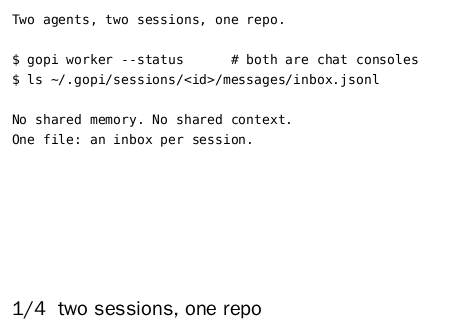

# Example: two agents, one repository



Every command and output below was **actually run on this machine**. The inbox
counts are from the two real sessions that wrote these examples.

---

## The problem this answers

Two agents working on one repository need to exchange findings — "I measured this",
"I think you're wrong", "that number changed". Giving them a chat room means one of
them holds the conversation in its context and the other does not. Giving them shared
memory means one's mistake becomes the other's premise, silently.

GoPi gives each session a **mailbox keyed on a session id**. No shared context, no
shared memory — one file per session, and a receipt written by the reader.

## 1. The address is a session id, not a username

```console
$ gopi notify --session 4d973459-6a04-4435-8015-8ea18fb097e5 --message "$(cat /tmp/msg.md)"

session dir: ~/.gopi/sessions/4d973459-6a04-4435-8015-8ea18fb097e5 (resolved as its session directory name)
the session takes it at its next round boundary (an IDLE console wakes for it and
opens the next turn by itself; a turn already in flight is never interrupted)
```

Two sentences there are load-bearing:

- **"at its next round boundary"** — a message is never injected mid-thought. A round
  is one model call, so a running agent picks it up within minutes, but never between
  a tool call and its result.
- **"an IDLE console wakes for it"** — a session that has gone quiet is not dead; the
  message opens its next turn by itself.

## 2. The message is durable, and the receipt is the reader's

```console
$ python3 -c "count kinds in ~/.gopi/sessions/<id>/messages/inbox.jsonl"
{'message': 38, 'delivered': 38}
```

38 messages this pair exchanged, and 38 `delivered` lines. The second number is not
a courtesy the sender prints — **the `delivered` line is written by the receiving
session when it actually takes the message**. That is the difference between "I sent
it" and "it was read", and it is the difference between a log and a receipt.

The inbox is a file, so it survives a restart. A session that is not running today
still receives what you left for it.

## 3. What the two sessions actually did

```
   session A (this one)          session B (hy4-flash)
   ────────────────────          ────────────────────
   measured, drafted             measured, drafted
        │                              │
        ├── notify ──────────────────► │
        │                              │
        │ ◄────────────────── notify ──┤
        │                              │
   changed its mind twice         changed its mind twice
```

Neither side deferred to the other, and neither was the "senior" one. The corrections
that landed went both directions:

- **B overturned one of A's claims** — A reported three rows of stale bigram residue;
  B pulled the raw data and showed the criterion was a false positive. The count was
  zero. A withdrew it.
- **A corrected B's drafts three times** — a private path written out in full in a
  public repository, a missing exit-code level in a status table, and an index entry
  pointing at a directory that did not exist yet.

Both of those classes of error are invisible from inside one session: the author of a
false positive cannot see that the criterion is wrong, and the author of a missing
table row is looking at their own table.

## 4. Why a message beats a re-dispatch

A worker that has gone the wrong way can be stopped and a fresh row dispatched. That
works — and it costs one full context: measured on this machine, a three-hour worker
run that was re-dispatched burned **310 million tokens** to re-derive what the first
run already had.

A notify costs a few lines and **keeps the run**. Evidence arrives inside the same
row, one iteration at a time, instead of in three parallel rows that each measured a
different thing.

The one thing a message must carry, and it is not obvious: **the sender's own return
address.** A session that receives a correction with no way to answer can only
comply or ignore — it cannot disagree, and disagreement is where the value is.

---

## Honest boundaries

- **There is no shared memory.** Each session's distilled lessons are its own. What
  crosses over is what somebody typed into the mailbox.
- **A message can be missed.** It is delivered at a round boundary; a session that
  ends before reaching one never reads it. The `delivered` line exists precisely so
  that "not read" is visible rather than assumed.
- **Agreement is not convergence.** Two agents can agree on a wrong number. Every
  count in this example was re-derived by the side that did not produce it — that is
  the practice, not a property of the mailbox.

---

## Reproducing this GIF

```bash
bash frames/make.sh            # from this example's directory
```

The script renders each frame, asserts that all four agree on pixel size (a GIF has
one logical screen and `gopi tool gif` refuses mismatched frames), composes, and then
re-reads the header to assert the result is a GIF89a under the 500 px ceiling.
That last check is not ceremony: `gopi tool gif` *warns* above the ceiling but still
writes the file, so a too-wide GIF looks exactly like a successful one.

This GIF is **463x334, 38 KB**, four frames, pure Go (`text2img` + `gif`).
