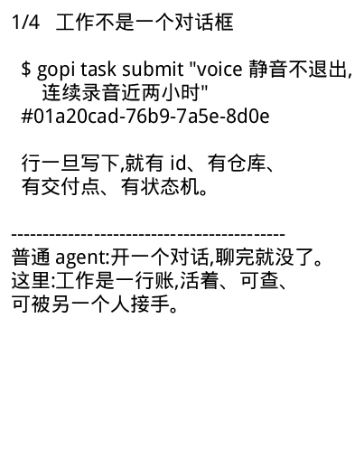

# task-and-git — 工作是一行账，不是一次对话



大多数 agent 的工作发生在一个对话框里：你问，它答，关掉就没了。谁在做什么、
做到哪一步、上次为什么失败——只有这一次对话记得。

gopi 的每一件工作是一行**账**：

```
$ gopi task submit "voice 静音不退出，连续录音近两小时"
#01a20cad-76b9-7a5e-8d0e-35a1affa2b8b
```

这一行写下的瞬间就有了 id、状态机、声明的仓库、和交付点。它此后可以被另一个人
接手、被列出来、被搜到、被审计——即便原来那个会话早就结束了。

## worker 拿的是自己的 clone

```
deliverable.repo:     /home/nick/work/gopi
deliverable.branch:   master
deliverable.worktree: /home/nick/workspace/01a20cad-...
```

不是「在项目里改文件」。每个 worker clone 一份，在自己的 clone 里工作，收尾时
自己 `pull --rebase` 合、自己 push 回去。**没有 merge 守护进程**——每个 worker
是自己的合并人，冲突自己解掉。代价是并发 push 可能输掉一次竞速，用重跑支付；
收益是十条任务真的能同时跑。

## 同一个终端里，两句话必须分开读

这是这个 example 里最有价值的一段，因为它**难堪**：

```
status:  completed
turns:   366
exit:    0

delivery (read now):
  DELIVERED — peer advertises master at this row's own tip 0db614b3

ground (resolved now):
  /home/nick/workspace/01a20cad-...
  NOT FOUND — a stale reading
```

`completed` 是**它对自己说的**。下面那两行才是测量：`delivery` 去远端问「你的
master 现在是哪个 tip」，`ground` 去磁盘问「那个目录还在不在」。同一个终端里，
它们可以互相矛盾，而 gopi 把矛盾原样打出来，不合并成一句「成功」。

一条跑完的 row 的 ground 被回收是正常的；但「ground 不在了」和「工作没交付」
是两件不同的事，所以这两行分开量、分开报。

## 账本自己也会认错

```
$ gopi task list
failed-needs-reissue: 256 failed row(s), no successor row
and no "resolved" tag — reissue or tag them
```

失败的行不会被藏起来，也不会被悄悄重试掉。它挂着，直到有人处理它——
重新派发、复制到干净房间、或者打上标签说明它不再欠什么。

## 自己复现

```bash
gopi task submit "your work"        # 写下一行
gopi task list --status pending      # 看队列
gopi task show <id>                  # 看它的 status / ground / delivery
gopi task status <id>                # 可恢复吗？退出码就是答案
```

## 帧源

`frames/*.txt` → `frames/*.png` → `task-and-git.gif`，由 gopi 自己的
`tool text2img` 与 `tool gif` 生成（纯 Go，无 ffmpeg / ImageMagick / Pillow）：

```bash
bash frames/make.sh
```
