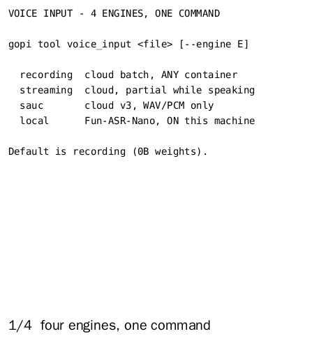

# Example: voice input (speech-to-text)

> Every command and output below is real — captured from an actual transcription run.


> Sample: the public-domain JFK inaugural `jfk.flac` (16 kHz).

gopi turns speech into text with **one command and four swappable engines** — cloud
batch, cloud streaming, cloud v3, or a fully local model. No runtime is baked in: a
fresh machine gets the zero-weight cloud default and is told what the alternatives cost.

## 1. One command, real output

```console
$ gopi tool voice_input jfk.flac --engine recording
And so, my fellow Americans, ask not what your country can do for you, ask what you can do for your country.
[voice] jfk.flac in 2.7s (chunk=15s)
[voice] first text at 2.7s (engine doubao) = engine/channel 2.7s
```

`EXIT=0`. The transcript is the real JFK line, verbatim.

## 2. Four engines

```
recording   cloud batch (Volcengine/Doubao auc); ANY audio container; waits for the whole file
streaming   cloud, same vendor, ONE websocket; PARTIAL transcript while you are still speaking
sauc        cloud v3 streaming; 16 kHz mono WAV / bare PCM only
local       Fun-ASR-Nano (SAN-M encoder + Qwen3-0.6B) on THIS machine; 1.7 GB weights, no upload
```

Default is `recording`: 0 B of weights on disk, audio uploaded. The default is chosen
because the burden is asymmetric — the local engine needs ~1.7 GB of weights plus a
runtime binary that gopi cannot fetch for you.

## 3. The container gotcha (real failure, then the fix)

Running the default engine on a flac fails — and the error names the way out:

```console
$ gopi tool voice_input jfk.flac                    # default engine = sauc
gopi tool voice_input: sauc engine: the streaming channel takes a WAV or bare PCM:
these bytes are neither (no RIFF/WAVE header) ... re-run with --engine recording jfk.flac
```

`sauc` must decode the container itself and has no flac decoder. `recording` uploads
the file as-is and the vendor decodes it, so flac/mp3 work there. Use WAV/PCM for
`sauc`, or switch to `recording` for arbitrary containers.

## 4. Privacy is stated, never implied

Every run prints on stderr exactly where the audio goes — and how to keep it local:

```console
[voice] PRIVACY — engine recording UPLOADS the audio to
https://openspeech.bytedance.com/api/v3/auc/bigmodel/submit (... volc.seedasr.auc);
the recording leaves this machine ... to transcribe ON this machine instead:
--engine local, GOPI_AUDIO_ENGINE=local, or "audio_engine": "local" in settings.json
```

This is not DeepSeek and not a gopi endpoint: speech uses a **separate vendor account,
separate credential, billed separately**. Leave the audio keys out and gopi reports the
voice path as unconfigured instead of failing at startup.

## Animated GIF

`voice-input.gif` — 4 frames, 480x492 px, 50 KB, pure Go (`text2img` + `gif`).
See `frames/make.sh` to reproduce.
