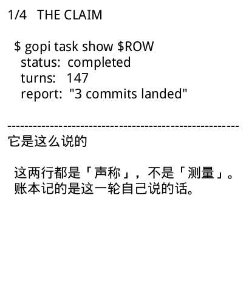

# Example: a PA that does not believe "completed"

> Every number below was read from this repository's own ledger, and every command
> is the one that produced it. Where a claim could not be verified, it says so.

`completed` is a status a run writes about itself. It is not a measurement, and the
two come apart in both directions. This example shows what a supervising session does
about it — and what is still unsolved.



## 1. The row says completed; the question is who measured it

A terminal row carries two different things:

```console
$ gopi task show <row-id>          # any terminal row — the fields are the point
status:         completed
summary:        bug: 行 01a20aa1-eee3 标 completed 但零产出——examples/ 目录不存在、
                全树无任何 .gif、交付腿自认 nothing to deliver
delivery (read now): DELIVERED — the peer <dev-repo> advertises master at
                this row's own tip <sha> — the run's work left this machine
```

The `summary` is what the run said about itself. The `delivery` line is what the
machinery measured just now, by asking the peer which commit its `master` points at.
Those are different claims with different authors, and a supervisor that reads only
the first is a forwarding address.

## 2. Three ways "completed" is not completion

Measured on this ledger (`gopi task list --status <s>`, counted at
2026-11-24T16:4x local):

| the failure | what it looks like | a real row |
|---|---|---|
| **false positive** | said done, changed nothing | a row whose own report opened with "nothing to deliver" |
| **false negative** | did the work; the gate looked in the wrong place and said zero | the row above — the artifact existed, 403547 B of it |
| **zero output** | exited 0, wrote no file | a run whose whole deliverable was a message |

The false negative is the one that costs most, because it is invisible: a run that
reports zero is indistinguishable from a run that produced nothing, and the honest
one gets re-dispatched while its work sits on disk. Row
A row on this ledger exists because of exactly that: the *subject*
of the sentence `rev-list --count` was "this tip", but it was written down as "this
run", so a commit that landed in another checkout counted as zero.

## 3. What the supervisor actually runs

Not a prose review — a measurement per row, and the cheapest one that can disagree
with the report:

```console
$ git merge-base --is-ancestor <commit-from-the-report> HEAD && echo on-master
$ git log --oneline --grep="<the report's commit SUBJECT>" HEAD    # hash may differ
$ git hash-object path/to/file                                   # vs the blob at HEAD
$ make build && ./bin/gopi --version | grep revision             # binary == source?
```

Two of those are load-bearing and easy to get backwards:

- **Verify by content, not by hash.** A clone-channel delivery rewrites commits
  (`pull --rebase` replays them), so the hash in a report is routinely *not* the hash
  on `master`. Searching by the commit's subject and then comparing trees or blob
  hashes is the check that actually holds. A hash that "does not exist" is a
  hypothesis about the delivery channel, not a finding about the work.
- **A stale binary lies about the source.** `--version` reports the revision compiled
  into the binary, not the revision of the tree it sits in. Rebuild before comparing.

## 4. The honest limit

This is a *practice*, not a gate. Nothing here stops a run from writing `completed`;
the ledger keeps the row, and the disagreement is resolved by a session that bothered
to look. The three failures above were all caught that way — by a measurement taken
after the fact — not by the system refusing the claim.

Two things that would make it a gate, and are **not** implemented:

- a delivery-proof arm that names *which* repository it measured, so a zero cannot be
  read as a global fact (partially improved; the scope clause still has to be read)
- a required evidence attachment per terminal row — refused on purpose, because a
  mandatory artifact gets written to satisfy the rule and carries no information

So the table in §2 is a taxonomy of *observed* failures, not a checklist that has been
enforced. A supervisor is still required, and still has to know which question to ask.

## 5. Reproducing the GIF

```bash
cd examples/worker-false-completion && bash frames/make.sh
```

Pure Go: `gopi tool text2img` renders each bilingual frame, `gopi tool gif` composes
them. Two constraints are measured, not stylistic — both are checked by the script,
because both fail *silently*:

- **The font must carry CJK.** Re-rendering the same frame with a Latin-only face
  (`DejaVuSansMono`) gives 740 px wide and 2.5% ink instead of 410 px / 4.9% — the
  Chinese lines become missing-glyph boxes and the width passes the 500 px ceiling.
  The GIF still builds.
- **Frames must be padded to one width.** The face is proportional, so a fixed display
  column count does not give a fixed pixel width: measured on `wqy-microhei`, the
  ASCII step is 4 px and the CJK step is 13 px (a true monospace face would be 2.00,
  this is 3.25). The script pads each frame to the widest instead of assuming equal.

`gopi tool gif` *warns* above 500 px but still writes the file, which is why the
script asserts on the produced artifact rather than on the tool's exit code.
