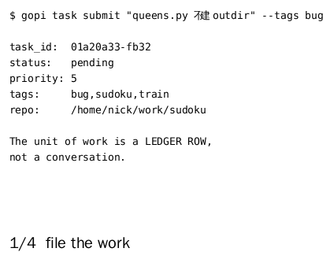

# Workflow dispatch — the work is a ledger row, not a conversation



Every command and every line of output below was **actually run on a real
machine**, against a real ledger. This is not a mock-up.

---

## The problem this answers

Most coding agents are conversations. You type, it types back, the context
fills up, and when the window closes **the work is gone** — no id, no state, no
record of what was attempted or why it stopped.

GoPi makes the **task row** the unit of work. A row has an identity, a state
machine, a place to live on disk, and an owner. A conversation is how you
*create* rows; it is not where they live.

The consequence: an agent can crash, a machine can reboot, a session can be
compacted — and the work is still there, resumable by id.

---

## 1. File the work

```console
$ gopi task submit "train/queens.py 存 npy 前不建 outdir，训练跑完才崩在保存上" \
    --tags bug --repo ~/work/sudoku

task_id:        01a20a33-fb32-7432-a02d-af098923f67a
status:         pending
session:        (no session id)  run directory holds no run log
summary:        bug: train/queens.py 与 graphcoloring.py 存 npy 前不建 outdir
model:          deepseek-flash
tags:           bug,sudoku,train
priority:       5
deliverable.repo: ~/work/sudoku
```

That id is permanent. It is what you resume, clone, archive or search by — not
a message in a chat log.

Note `priority: 5` is derived from the tags; **a `bug` tag sets it to 1**, which
is the highest queue weight. An LLM-reported bug outranks ordinary work by
default, because a defect nobody filed stays live.

## 2. The queue is queryable, not a mental list

```console
$ gopi task list --status pending

3 task(s) with status=pending:
ordered newest first (created_at DESC); pending rows are CLAIMED
priority-first, and each pending row is marked with its queue position
#01a20a3e-3309  [pending]  clone 通道 push 必被拒：rowRepo 臂选中本机非裸仓
#01a20a3d-804a  [pending]  standards 门 TestGate7 在未改动树上红          [next]
#01a20a33-fb32  [pending]  bug: queens.py 存 npy 前不建 outdir
```

The `[next]` marker is not decoration — it is computed by the **same predicate**
the claim funnel uses, so the row you see marked is the row that will actually
be handed out. A view that disagreed with the funnel would be a bug.

## 3. Workers run one row each, in their own clone

```console
$ gopi worker --status

gopi worker pid 1068649: FOREGROUND task=01a20a32-6eac (holds no daemon lock)
gopi worker pid 1090039: FOREGROUND task=01a20a38-174c (holds no daemon lock)
gopi worker pid 1102210: FOREGROUND task=01a20a34-c43a (holds no daemon lock)
```

Three rows running at once, each in its **own git clone**, each merging itself.
No central merge daemon: a single resident merger serialised every merge in the
system and was the bottleneck.

`gopi worker` is **not a daemon**. It runs tasks until the queue drains and
exits. There is nothing to babysit and nothing that outlives its purpose.

## 4. The supervisor watches an event stream, not a screen

```console
$ tail -f ~/.gopi/notify/task-events.jsonl

{"event":"claimed",     "previous_status":"pending",     "task_id":"01a121f8-550d"}
{"event":"in_progress", "previous_status":"claimed",     "task_id":"01a121f8-550d"}
{"event":"completed",   "previous_status":"in_progress", "task_id":"01a121f8-550d"}
```

A task moves `pending → claimed → in_progress → completed`, and **every
transition is an event you can subscribe to**. That is how a supervisor (human
or agent) learns a worker failed without polling anything.

The subscription is one config key:

```json
"notify": {
  "cmd": "bash ~/.gopi/notify/notify.sh",
  "events": "all",
  "async": false
}
```

## 5. When a row fails, it is RESUMED — not replaced

This is the part most task systems get wrong. A failure judges **one attempt**,
not the work:

```console
$ gopi worker --resume 01a20a33-fb32-7432-a02d-af098923f67a
```

Same task id, same session id, same directory, checkpoint appended. The context
the first attempt built is not thrown away.

A **clean-room retry** is a different verb, and it is the second rung:

```console
$ gopi task clone 01a20a33-fb32 --reason "first attempt chased the wrong root cause"
```

That mints a new row with a **new** session and a **new** ground, carrying the
briefing verbatim but no context. Use it when the approach was wrong and the
accumulated context is a liability.

---

## Why this matters in practice

| Without a ledger | With a ledger |
|---|---|
| context fills → work lost | row keeps its id across sessions |
| "did that fix land?" | `gopi task show <id>` — status, ground, branch, verdict |
| a crash ends the attempt | `gopi worker --resume <id>` continues it |
| parallel work corrupts one tree | each worker owns a clone, merges itself |
| supervisor polls a screen | supervisor subscribes to events |

---

## Reproducing this GIF

The frames are rendered from **real command output** pasted into text files,
then composed by GoPi's own tools — no ffmpeg, no ImageMagick, no Node:

```bash
# 1. every frame padded to the same width and height
#    (a MONOSPACE --font makes equal character count == equal pixel width)
FONT=/usr/share/fonts/truetype/dejavu/DejaVuSansMono.ttf
./bin/gopi tool text2img f1.pad.txt f1.png --size 13 --cols 60 --lh 20 --lines 14 --font "$FONT"

# 2. verify the frames agree — a GIF refuses mixed canvases
python3 -c "import struct;d=open('f1.png','rb').read(33);print(struct.unpack('>II',d[16:24]))"

# 3. compose (--caption adds the subtitle band)
./bin/gopi tool gif --frames f1.png,f2.png,f3.png,f4.png --out demo.gif \
    --delay 250 --caption "f1.png=1/4  file the work"
```

Two constraints worth knowing before you build your own:

- **Width must stay ≤ 500 px** for a phone messaging view. `--cols 60` at
  `--size 13` gives 424 px. The tool *warns* above the ceiling but still writes
  the file — so a too-wide GIF looks like success.
- **The default font is proportional**, so padding every frame to the same
  character count does **not** give the same pixel width. Pass `--font` with a
  monospace face.

See [`docs/quickstart.md`](../../docs/quickstart.md) for the full recipe.
